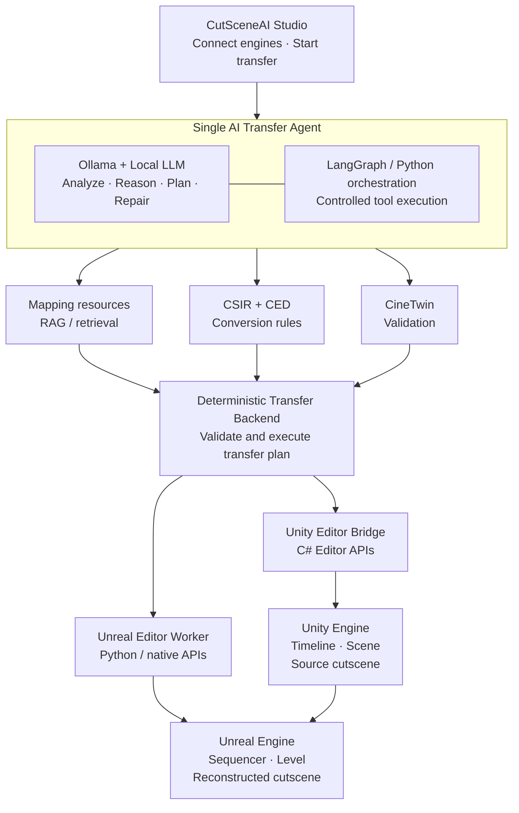

# CutScene Studio — Living Development Context

Last updated: 2026-11-26. This is the canonical handoff for the **new standalone repository**, not the earlier AI-agent research Studio.

## 1. Start here in every new chat

1. Read this file and root [AGENTS.md](AGENTS.md) before proposing or making changes.
2. Verify the current GitHub repository, branch HEAD, working-tree status (when a local checkout is available), open PR and most recent CI results. Do not assume this document is newer than Git.
3. Read the relevant implementation and regression tests; continue from the first unresolved item below unless the owner requests a different task.
4. Update this file in the same commit or PR as every code, configuration, documentation, test, or workflow change. Record native test observations and decisions here as they occur, even when no implementation changes are required.
5. Push requested changes to the active branch, verify the resulting commit, and report actual test results, blockers and local steps. Do not claim an engine test was run remotely when it was not.

Resume prompt: "Read context.md and AGENTS.md from Nithin0553/CutScene-Studio on feature/deterministic-studio-v1. Verify the latest repository state, then continue from the last unresolved step."

## 2. Repository and release state

- Repository: https://github.com/Nithin0553/CutScene-Studio (public; no declared open-source license).
- Active integration branch: `feature/deterministic-studio-v1`. Default branch `main` contains initial project documentation, not the working Studio; do not tell users to clone main for the working Studio.
- Draft PR [#1](https://github.com/Nithin0553/CutScene-Studio/pull/1), targeting main. Do not merge or publish a certified release without owner approval and the acceptance evidence below.
- Original repository: `Nithin0553/CutsceneAI`; historical only. Do not change it while working on the standalone Studio.
- Exact pre-agent baseline in original repository: `3b3ef7071e4e23efefa4d1ac6c7dee3c26738153`. Selected deterministic improvements also sourced from original main snapshot `28c63e5c1eb65f499f21508b9491d7f0e9b88a5b`.
- Latest code baseline before this handoff: `9245e5b1ca467a44c03a23c28329a1fe7669a53e`. Git HEAD, not a hardcoded hash in this file, is the authoritative current revision.

## 3. Product direction and constraints

Build a reliable local Unity Timeline to Unreal Level Sequence transfer Studio. On 2026-11-26 the owner explicitly approved the single-agent Ollama + LangGraph architecture below, superseding the previous no-agent product direction. Preserve the existing deterministic execution backend as the foundation and regression baseline; no cloud API or learning/dataset collection is required. The current implementation remains deterministic until the approved integration is implemented and verified.

First release is scoped to the cinematic elements of Benchmark 001 and 002. Avoid benchmark-name-specific logic, assumptions about scene names, or fixed private paths. Use the source as authoritative. Keep the UI clean, minimal and responsive with meaningful progress animation. Do not emit unnecessary files, commit generated artifacts, overwrite existing target sequences, or restart engines repeatedly. Explicit editor approval, source asset-copy rights, backed-up target projects and guarded native execution remain required.

### Approved target architecture (mandatory; not yet integrated)

Approved by the user on 2026-11-26 from the supplied "Proposed CutSceneAI architecture" diagram. This is the sole architectural baseline for CutScene Studio. Do not introduce alternative architectures, additional agents, or change component responsibilities or connections without explicit user approval.



### Component responsibilities and interfaces

- **CutSceneAI Studio:** the user-facing interface for connecting engines and starting transfers; displays progress, diagnostics and validation results.
- **Single AI Transfer Agent:** the only AI agent. Ollama + a local LLM provide analysis, reasoning, planning and repair decisions. LangGraph / Python orchestrates controlled tool execution. Use a configurable local Ollama API (default http://localhost:11434); model choice is pending hardware and capability verification.
- **Mapping resources:** RAG / retrieval of relevant engine conversion knowledge, preferring exact component and version matches before optional semantic retrieval. Inspect prior mappings before reusing them.
- **CSIR + CED:** engine-independent cutscene representation and conversion rules/coverage. Source census can support extraction and coverage within these existing responsibilities; it is not an additional architectural layer.
- **CineTwin:** source-to-target validation and discrepancy evidence for bounded repair; validation feedback returns to the same single agent through controlled tools.
- **Deterministic Transfer Backend:** validates and executes the transfer plan using explicit conversion algorithms, schemas, job state and engine adapters. The three knowledge/validation components inform backend execution as shown in the approved diagram.
- **Unity Editor Bridge:** C# Editor APIs connect to Unity Engine and extract Timeline, scene, source cutscene, assets and capabilities.
- **Unreal Editor Worker:** Python / native APIs connect to Unreal Engine, import assets, create actors, reconstruct the Sequencer and Level, and obtain target readback.
- **Unity Engine → Unreal Engine:** the initial transfer direction. Unity contains the source cutscene; Unreal contains the reconstructed cutscene. The arrow denotes the transfer outcome, not an unmediated engine-to-engine API bypass.

### Non-negotiable implementation constraints

- Keep one Ollama-powered AI agent with LangGraph / Python orchestration. Do not substitute a multi-agent design, another orchestration architecture, or a parallel transfer pipeline without explicit approval.
- The agent selects grounded conversion strategies, invokes allowlisted tools and proposes supported repairs. Deterministic calculations, conversion, validation and editor mutations remain in the backend and engine adapters.
- Validate tool arguments and transfer plans, retain provenance, bound repair attempts, and explicitly report unsupported or partial conversions. Avoid arbitrary generated code execution and unintended changes to source projects.
- Preserve the diagram's named components and topology. Implementation details may evolve within their responsibilities; architectural changes require explicit user approval and a context.md update.
- Existing deterministic components on this feature branch must be inspected and reused where suitable; the Ollama/LangGraph integration is not yet verified.
- No runtime implementation or real-engine transfer test is implied by architecture approval.


### 2026-11-26 — Storage check passed; model load bottleneck confirmed

- Owner ran the Windows launcher with -StorageRoot and -CheckOnly successfully. Reported repository, storage root, run workspace, Python executable, HF_HOME, npm_config_cache, PIP_CACHE_DIR, TEMP, TMP and UPM_CACHE_ROOT are all on D:. Studio was not started. This verifies launcher configuration and prerequisites, not actual native runtime writes or Unreal cache redirection.
- From the previous Ollama request: load 95.21 s, prompt evaluation 0.89 s, generation 4.44 s, total 102.37 s (remaining overhead 1.83 s). Model loading accounts for approximately 93% of total latency. Keep the existing Qwen 2.5 7B model. For the proposed agent, reuse a loaded model within bounded active transfer sessions (short configurable keep_alive) and release it when idle or on transfer completion; measure warm latency and memory pressure before tuning. No new model download is needed. Tool-calling and grounded decision quality are still unverified.
- Added tests/studio/test_windows_storage_launcher.py (4845d8a), a Windows integration regression invoking the real launcher in check-only mode with a temporary path containing spaces and asserting all reported paths and created directories. Skips on non-Windows or if the required installed Studio virtual environment/PowerShell is absent. New automated test not yet executed; owner manual launcher check passed.
- Next: fast-forward the existing feature branch, configure D: cache/temp variables in the current PowerShell session, install only the missing pytest/Ruff test dependencies into the existing D: virtual environment, and run the targeted launcher regression followed by the existing test suite, using a unique D: pytest basetemp. Do not install agent dependencies or launch native engines yet. Verify engine versions and existing Unreal bootstrap/cache paths before live backend/worker workspace checks. Preserve the 15 untracked Unity metadata files and historical runs.

### 2026-11-26 — Ollama smoke test and first storage implementation (prior checkpoint)

- Owner created workspace directories and configured process-local pip/npm/Hugging Face/Unity caches and TEMP/TMP on D:. Ollama /api/tags succeeded. The installed qwen2.5:7b-instruct model completed a JSON-schema /api/generate request (num_ctx=2048, num_predict=256, temperature=0, keep_alive=0): done=true, reason=stop, total 102.37 s, 52 prompt tokens, 44 generated tokens, 9.9 generated tokens/s. JSON parsed successfully; target "Unreal Engine Sequencer" and strategy "Conversion Strategy for Unity Timeline to Unreal Engine Sequencer" were too generic to use as conversion decisions. Structured output alone is not semantic validity. Need grounded mapping selection and separate tool-calling test; measure load/prompt/generation timings, don't assume inference bottleneck.
- Existing Python 3.12.10 environment: jsonschema 4.26.0, pydantic 2.14.4, PyYAML 6.0.4; pip check reports no broken requirements. Ollama SDK, LangGraph, LangChain, pytest and Ruff absent in provided list. No new models/dependencies installed.
- First implementation: tools/start_studio.ps1 now accepts -StorageRoot and -CheckOnly, defaults root to parent of repository, creates runs and process-scoped cache/temp directories, checks existing Python prerequisites and supplies --workspace to existing backend CLI. Existing UI generates Unreal worker command with backend's actual workspace, so no backend/worker source changes were needed for this narrow launcher path. README updated. Old home-directory runs not moved; direct CLI defaults and legacy Unreal startup scripts remain to audit. Do not launch a second worker or relocate an active job; no blanket guarantee for third-party editor/system caches. Ollama location unchanged.
- Changes: f2ee5fbe (launcher), 66a9c526 (README). Verified source inspection only; PowerShell runtime and native integration have not been tested in this session. The owner subsequently passed the manual launcher check; see latest checkpoint above for next tasks. No engine restart or transfer was performed.

### Environment verification (prior checkpoint, 2026-11-26)

- Owner's PowerShell output confirms the feature branch fast-forwarded successfully to f5b54fe, matching its remote at the time. All 15 untracked Unity .meta files remain intact. No new clone, branch switch, reset or clean needed.
- Dell G15 5511, 15.73 GB RAM, NVIDIA RTX 3050 with 4096 MiB VRAM, 1,529.80 GB free on D:. Existing .venv-studio runs Python 3.12.10. Ollama 0.18.2 is installed on D: and reports qwen2.5:7b-instruct (4.7 GB). OLLAMA_MODELS already points to D:\AI\Models\Ollama. Reuse this shared model location instead of moving/downloading models. Verify API and actual inference; model compatibility with structured outputs and tools is not yet tested. 4 GB VRAM/16 GB RAM means partial CPU offload and editor memory contention are likely; start with a small context and release the model when idle.
- Inspected tools/start_studio.ps1, tools/studio_local_bridge.py and integrations/unreal/studio_local_editor_worker.py: backend CLI already accepts --workspace; worker start(workspace=...) accepts the same path. Both default to Path.home() / '.cutscene-studio' / 'runs'; launcher does not yet expose workspace. Launcher now exposes a portable storage root; check-only and backend/worker/bootstrap validation and regression tests remain pending. Do not launch with the default home directory, or reconnect an active worker to a different workspace without checking outstanding jobs. Preserve historical runs.
- Initial local checks completed; see latest checkpoint above. Confirm engine versions, engine project and cache paths before native launch. No model pull, dependency install, code change or inference/test has been performed by this chat.

### Local setup checkpoint (2026-11-26; prior observation)

- Owner confirmed the correct existing clone on D: (Dimpu), with 1,529.80 GB free, local HEAD 9245e5b on feature/deterministic-studio-v1, and an existing .venv-studio. The machine-specific workspace path is recorded in [main context](https://github.com/Nithin0553/CutScene-Studio/blob/main/context.md). Do not clone again or switch to main.
- User's git fetch showed origin/feature/deterministic-studio-v1 at fc2682b, three commits ahead. GitHub comparison confirms those commits only changed AGENTS.md, CONTRIBUTING.md, README.md and context.md; preserve all 15 untracked Unity .meta files. Re-fetch before a fast-forward, inspect incoming added paths for collisions, do not clean/reset/stash/delete metadata blindly.
- D: is mandatory for project-owned files, models, dependencies, engine projects, assets, runs, logs, caches and temporary files. Existing default run storage under ~/.cutscene-studio/runs is a migration blocker; inspect configuration and redirect backend and Unreal worker consistently before launch. Preserve existing native evidence. Windows/tool system settings may still reside on C:.
- The fast-forward and initial hardware checks are now complete; follow the environment checkpoint above. No new code or native tests performed in this session. Historical B001/B002 evidence and open acceptance tasks below remain relevant; they do not certify the new AI architecture.

## 4. Architecture and implementation map (existing deterministic baseline)

```text
Unity Timeline + PlayableDirector
  -> Unity extractor / source component census (read-only source)
  -> CSIR + source evidence
  -> deterministic CED retrieval / feature dispatch / mapping / transfer plan
  -> immutable prepared candidate + destination preflight
  -> explicit guarded Unreal worker job
  -> asset import / actor setup / Level Sequence generation
  -> native readback + CineTwin comparison / evidence / diagnostics
```

| Area | Main location |
| --- | --- |
| Windows setup and launch | tools/install_studio.ps1, tools/start_studio.ps1 |
| Local API, discovery, approval, job queue | tools/studio_local_bridge.py |
| Primary UI | apps/studio-web/index.html, cinematic.js, cinematic.css |
| Legacy advanced UI | apps/studio-web/app.js; ?advanced=1 |
| Unity package | integrations/unity/com.cutsceneai.extractor/ |
| Deterministic planning | packages/studio/ (transfer_backend.py, prepared_transfer.py, feature_dispatch.py, ced_discovery_registry.py, source_surface_gap.py) |
| Source asset inspection | tools/studio_auto_assets.py, studio_source_identity.py, studio_source_materials.py |
| Unreal editor integration | integrations/unreal/studio_local_editor_worker.py, studio_planner_sync.py, studio_destination_preflight.py, studio_auto_scene.py, studio_generation_readback.py |
| Verification | packages/cinetwin/, packages/validation/, Unreal native readback and persistence audits |
| Regression and hygiene | tests/, .github/workflows/ci.yml, tools/repo_check.py |

Studio uses a localhost HTTP server at port 8765 by default. The Unreal worker uses a file queue and Slate editor tick callback, not arbitrary remote code execution. The worker protocol is currently studio-editor-v0.6; host validates checkout and worker source hash. Local run evidence is under `~/.cutscene-studio/runs`. Source exports are inside the Unity project; generated assets are in Unreal. None belong in Git. Unity uses an explicit Export for Studio action, not a live heartbeat bridge in this version.

## 5. Installation and usage

Windows prerequisites: Git, Python 3.11+ with Tkinter, Unity 6 (package declares 6000.0 and Timeline 1.8.10), compatible Unreal Editor (UE 5.8 used in the owner's current test), and user-provided engine projects. Other engine/OS combinations are not certified.

```powershell
git clone --branch feature/deterministic-studio-v1 https://github.com/Nithin0553/CutScene-Studio.git
cd CutScene-Studio
powershell -ExecutionPolicy Bypass -File .\tools\install_studio.ps1
powershell -ExecutionPolicy Bypass -File .\tools\start_studio.ps1
```

Open http://127.0.0.1:8765. In Unity Package Manager, add from disk `integrations/unity/com.cutsceneai.extractor/package.json`. Save scene/Timeline, select PlayableDirector in Edit Mode, then Tools > CutsceneAI > Export for Studio. In Unreal enable Python Editor Script Plugin and Editor Scripting Utilities (initial activation may require restart). Use a saved backed-up destination level. In Studio choose both project roots and copy the connection command into Unreal Output Log in Python mode. Select cutscene, level, asset rights, Connect Projects, matching Source details, Start Transfer. Keep Allow partial transfer off for strict benchmarks.

Use the generated command rather than copying any old project-specific paths. The current command binds to the exact checkout and workspace. To update: stop the localhost server, pull the active branch, restart server and hard-refresh browser. Reinstall dependencies only when necessary. If Git reports dubious ownership on a trusted filesystem, add only the specific repository to safe.directory; never disable ownership checks globally.

### Unreal automatic startup and previous blocker

Confirmed in owner's native session: an old `Content/Python/init_unreal.py` in the destination project automatically loaded the older repository from a different drive and the legacy `~/.cutsceneai-studio/runs` workspace. Restart alone failed until that startup script was backed up and updated to load the new checkout and `~/.cutscene-studio/runs`. After fully closing Unreal and reopening, the user reported the new module path, new workspace and a registered delegate handle. A project-local bootstrap is optional for new users; preserve unrelated startup content and do not automatically overwrite existing scripts. Automatic installation from Studio is not implemented.

For connection troubleshooting, in Unreal's Python Console inspect:
```python
import studio_local_editor_worker as w; print(w.__file__); print(w.WORKSPACE); print(w.HANDLE)
```
Use the correct checkout, workspace, target project and level. If an old module is cached, stop it only when no job is active, save, fix conflicting project startup settings, completely close Unreal, and reopen once. Never reload or purge arbitrary engine modules during a running job.

## 6. Evidence and current status

| Area | Evidence / state |
| --- | --- |
| Deterministic standalone integration | Implemented on active branch; prior historical benchmark passes are not new certification |
| Windows install and localhost UI | Automated checks pass; owner launched and used UI locally |
| Unity source export | One menu action writes unique CSIR and matching census; owner selected Benchmark 001 in UI |
| Unreal connection | Owner confirmed correct new module, workspace and registered handle after fixing startup script |
| Native sequence generation | Owner screenshot shows generated Level Sequence open in Unreal AI_Test04 with tracks and Benchmark_Event_01 marker; no complete run receipt or fidelity report supplied |
| Native visual result | Screenshot showed dark/black viewport; cause not established. Could be empty/unlit environment, camera/framing, asset setup, or visibility issue. Inspect before changing source-equivalent scene |
| Benchmark 001 | New native full acceptance not yet verified |
| Benchmark 002 | New native full acceptance not yet verified |
| Automated tests | Verified at handoff HEAD 3702f93: [push CI 45452676096](https://github.com/Nithin0553/CutScene-Studio/actions/runs/45452676096) and [PR CI 45452697076](https://github.com/Nithin0553/CutScene-Studio/actions/runs/45452697076) succeeded; push jobs on Windows and Ubuntu passed Python compilation, pytest, JS syntax and UI regression, Ruff and repository hygiene. Last implementation baseline 9245e5b also passed. |
| Public stable release | Not merged; no declared license; release candidate only |

Known UI limitations: project folder checkmarks/toast are not proof of a live editor connection; transfer screen now reflects actual target editor validity, but project screen still has folder-validation indicators. Multiple valid matching source records require manual selection; auto-select exists only for a single valid match. Source details may include partially captured components (collision/URP/signal behavior not Unreal-verified). Keep those limitations explicit. No blanket partial-transfer override to hide errors.

## 7. Benchmark acceptance

Authoritative references: [Benchmark 001](docs/benchmarks/BENCHMARK_001.md), [Benchmark 002](docs/benchmarks/BENCHMARK_002.md), benchmark source/target freeze and pipeline correction docs. Treat historical docs as evidence from the original system, not current branch/CI status.

- B001: one humanoid and skeletal clip, root/keyed motion, moving prop, two cameras and cut, animated camera transform, FOV/lens, audio, event and static environment. Verify structural, timing, spatial, animation and audio/event fidelity in native engines.
- B002: 12 seconds, 24 fps, two independently animated characters (overlapping clips and root motion), moving and parented props, three cameras with cuts at 4 and 8 seconds, animated lens/light, overlapping audio with fades, three events including payload. Material/environment fidelity must be inspected where authored. Do not hardcode names or timing into general conversion.
- Inspect generated actors/assets, hierarchy, root trajectories and orientations, camera identities/cuts/framing/lens, timing, blend/section behavior, light/material/audio/event behavior. Report unsupported features and quantization explicitly. Save/reopen Unreal level and sequence and verify persistence. Preserve original source and targets.
- Generated sequence alone does not equal verified cinematic fidelity; require source-bound readback and measured acceptance evidence. Arbitrary skeleton retargeting, scripts/shaders, VFX, physics/gameplay and broad unsupported combinations are outside the first-release promise.

## 8. Prior deterministic acceptance work (retain as baseline; current setup checkpoint above takes precedence)

1. Continue the owner's native Benchmark 001 test from the generated sequence. Collect Studio Results, run/job ID, native receipts/readback, output log and Unity/Unreal comparisons. Inspect actors and camera view in the dark level; distinguish missing environment light from failed transfer before modifying anything. A Basic/Open World map may be useful for separate visual testing, not as unreported benchmark evidence.
2. Diagnose any actual fidelity gaps, implement general deterministic fixes with regression tests, push and re-test native B001 including save/reopen.
3. Run B002 in a fresh backed-up target, verify all its requirements and persistence; record unresolved scope honestly.
4. Improve onboarding: clear distinction between valid folder vs live editor; safely resolve matching source details without manual selection when unambiguous; project-local companion installation/repair with explicit approval, backups and conflict detection. Avoid repeated engine restarts.
5. Review the draft PR, confirm clean checkout install and current CI, document license/release decision with owner, and merge/tag only after explicit approval and acceptance.

### Resume checkpoint: collect B001 evidence before changing conversion

- On the existing local run, open Studio > Results (or View Previous Transfer Report) > View Report. Capture the sequence name, asset/binding counts, job status, native structure, persistence, CineTwin and visual status. The Results UI deliberately does not equate generation success with fidelity. A screenshot of the report and both engine views at matching timeline positions is useful.
- Preserve the existing candidate and saved output. In PowerShell, read the active job pointer and corresponding job JSON without changing anything:

```powershell
$root = Join-Path $HOME '.cutscene-studio\runs'
$active = Get-Content -Raw (Join-Path $root 'active-job.json') | ConvertFrom-Json
$job = Get-Content -Raw (Join-Path $root ('jobs\' + $active.job_id + '.json')) | ConvertFrom-Json
$job | Select-Object job_id,candidate_id,status,generation_status,generated_sequence,sequence_path,assets_imported_count,bindings_created_count,fidelity_verified,visual_audit_status,closed_loop_status,error | Format-List
Get-ChildItem -LiteralPath (Join-Path $root ('candidates\' + $job.candidate_id)) -File | Select-Object Name,Length
```

- The active pointer may refer to a newer run: confirm the job and generated sequence match B001 before relying on them. Retain the exact job's receipt, generation readback, hierarchy audit, diagnostic and closed-loop report when available. Missing evidence is not a passing result. Review all local logs, file paths and reports for sensitive information before sharing; never commit them. Do not share `/api/status` output because it contains a local token.
- In Unreal, inspect the saved destination level in a free Perspective viewport with Sequencer camera lock disabled, frame an existing generated actor, and compare Lit and Unlit view modes. Scrub the same timeline frame with camera lock enabled and compare with Unity. If the actor is visible in Unlit but not Lit, lighting is a candidate cause; if the camera view alone is black, inspect camera binding, transform and cut before altering the environment. Do not add lights, move actors, replace cameras or regenerate the candidate as a first diagnostic step. A different map is a separate test, not evidence for the existing run.
- Once the scene is saved and the initial evidence is captured, a controlled reopen in a new Unreal process is needed for independent persistence verification; this is an acceptance test, not a recurring connection requirement.

Implementation inspected at 3702f93: `apps/studio-web/cinematic.js` Results and View Report, `tools/studio_local_bridge.py` job/diagnostic/verification endpoints and `integrations/unreal/studio_generation_readback.py`. No implementation change is justified until native evidence identifies the gap. Local working-tree status and native engine results cannot be verified from the GitHub connection alone.

### Optional research direction: existing level-transfer baselines and cinematic model adaptation (2026-11-24)

Owner requested a literature and working-model feasibility review, not implementation or integration into the default Studio. Preserve deterministic production transfer, benchmark freezes and native acceptance steps above. This is a proposed isolated, offline research experiment; no pretrained model has been run or fine-tuned here.

- Direct scene transfer: [Bondar and Kugurakova (2025), Problems, Solutions and Perspectives of Automated Transfer of Game Scenes Between Game Engines](https://rdl-journal.ru/article/download/907/941/1499) surveys migration and describes a scripted Unreal-to-Unigine pipeline ([paper-linked exporter](https://github.com/Bonndii/UEtoUnigineExporter), availability not independently verified). [Project Exodus](https://github.com/NegInfinity/ProjectExodus) is a BSD-3 Unity-to-Unreal scene converter for older Unity 2018.3/UE4.25; reference its scene/asset mapping or reproduce with compatible versions. [OpenUSD](https://openusd.org/), [Unity USD toolkit](https://github.com/Unity-Technologies/com.unity.usd-toolkit) and [Unreal USD integration](https://dev.epicgames.com/documentation/en-us/unreal-engine/universal-scene-description-usd-in-unreal-engine) are interoperability references; current toolkit version compatibility requires checking. [Datasmith](https://dev.epicgames.com/documentation/en-us/unreal-engine/datasmith-import-process-in-unreal-engine) is a limited animated-transform/Level Sequence comparison. These are not trainable neural checkpoints.
- Learned level translation: [tile2tile (AIIDE 2022)](https://arxiv.org/abs/2208.07699), [code](https://github.com/riffsircar/tile2tile) has training scripts and trained-model directories for 2D tile/affordance translation; architecture inspiration, not directly reusable cinematic weights (verify license before reuse). [Joint Level Generation and Translation Using Gameplay Videos (CoG 2023)](https://arxiv.org/abs/2306.16662) and [Multiverse (2026 preprint)](https://arxiv.org/abs/2603.26782), [MIT code](https://github.com/bic4907/Multiverse-multigame-pcg) are methodological references; downloadable checkpoints not confirmed. Level style/generation is not source-faithful cross-engine cutscene conversion.
- Trainable candidates: [CodeT5+ (EMNLP 2023)](https://aclanthology.org/2023.emnlp-main.68/), [220M checkpoint, BSD-3](https://huggingface.co/Salesforce/codet5p-220m) for constrained structured mapping/plan proposals; compare pretrained, fine-tuned and random-init or simple classifier/rule baselines. [Skeleton-Aware Networks (SIGGRAPH 2020)](https://arxiv.org/abs/2005.05732), [code and pretrained demo instructions](https://github.com/DeepMotionEditing/deep-motion-editing), and [R2ET (CVPR 2023)](https://arxiv.org/abs/2303.08658), [MIT implementation](https://github.com/Kebii/R2ET) for different-rig motion retargeting only; verify weights, licenses/data rights, topology, dependencies and actual inference. R2ET documents old Python/PyTorch/CUDA dependencies; isolate from Studio. Same-rig transfer should use deterministic methods first.
- Proposed experiment: use existing CSIR (entities, tracks, relationships, rational time, provenance), CED and target capability evidence as input; train a constrained model to propose only allowed semantic mapping/strategy IDs or typed plan actions with an explicit abstain option. Do not predict numeric transforms/timestamps, invent bindings, or execute generated code. Deterministic planning, source/target identity and coverage checks, native preflight, non-overwrite guards and CineTwin readback remain authoritative. Motion specialist is optional and separately evaluated against native IK retargeting and source motion. No agent/LangGraph is needed.
- Data: existing `packages/dataset/registry.py` is immutable **source-only** registration, not supervised target labels. See `docs/architecture/STUDIO_DATASET_AND_ORCHESTRATION_V0_1.md` and `packages/contracts/csir/csir-v0.1.schema.json`. Collect independently authored Unity cases, reviewed equivalent Unreal plans, target capability/version, native readback, measured metrics and explicit unsupported/failed labels with provenance and rights. Existing 5-project/20-scene collection proposal is a pilot, not a guarantee of sufficient training. Keep frozen B001/B002 and whole unseen projects/asset families out of training and tuning. Avoid copying unverified converter outputs as ground truth.
- Evaluation: compare native deterministic Studio, compatible USD/scene converters on overlapping capabilities, simple learned baseline, pretrained vs fine-tuned model and optional motion specialist. Measure mapping coverage/accuracy, abstention, exact bindings/cuts/events, timing and pose/trajectory/lens errors, audio/event limitations, visual and save/reopen evidence, manual intervention, latency and native success rate. Only promote a model if independently measured gains over deterministic baseline are demonstrated without regression or safety bypass. No comparable full editable Timeline-to-Sequencer pretrained checkpoint was found in this scoped search; not a novelty proof or exhaustive systematic review.
- Next research action if owner approves implementation: pin and reproduce selected upstream baselines/checkpoints in isolated environments, confirm license/asset rights, formalize paired reviewed target label schema and dataset split, then conduct pilot transfer and ablation. Native B001/B002 acceptance remains outstanding; no default pipeline changes or release authorization.

## 9. Verification commands

```powershell
powershell -ExecutionPolicy Bypass -File .\tools\install_studio.ps1 -Dev
.\.venv-studio\Scripts\python.exe -m pytest -q
.\.venv-studio\Scripts\python.exe -m ruff check tests
node --check apps/studio-web/app.js
node --check apps/studio-web/cinematic.js
node tests/studio/test_cinematic_ui.cjs
.\.venv-studio\Scripts\python.exe tools/repo_check.py
```

Node.js is only needed for UI tests. CI checks compileall, Python regressions, JS syntax/UI tests, Ruff and hygiene on Windows and Ubuntu. Actual Unity compilation and Unreal native execution must be verified separately; use local evidence supplied by the owner when the engines are not accessible.

## 10. Change log and maintenance

Keep this concise and newest-first. For every change add date, summary, affected paths, tests/evidence, remaining blockers, and next action. Refresh sections above when facts change. Do not include credentials, private absolute paths, personal details or generated logs in this public handoff. If older entries grow too long, archive them with provenance rather than losing unresolved work.

| Date | Change / evidence |
| --- | --- |
| 2026-11-26 | Owner passed Windows launcher check-only on D:; measured 95.21 s model load and 4.44 s generation. Added Windows launcher regression; automated execution and native tests pending. Next: local regression and baseline suite. |
| 2026-11-26 | Owner verified Ollama structured inference and dependency health; implemented portable Windows launcher storage root/check-only mode and README usage. No PowerShell or native runtime tests performed remotely; local verification pending. |
| 2026-11-26 | Owner confirmed feature branch synchronization and hardware/Ollama/venv configuration. Inspected existing backend and worker workspace overrides and identified launcher configuration gap. Reuse Qwen 2.5 7B and D: model storage; inference, dependency and native checks pending. Documentation only. |
| 2026-11-26 | Owner approved single-agent Ollama/LangGraph target and D: storage, confirmed existing local feature branch and untracked Unity metadata. Reconciled context/AGENTS direction with approved architecture; no implementation or tests run. Next: safe fast-forward, environment and storage verification. |
| 2026-11-24 | Literature/model feasibility review recorded in section 8: direct scene converters vs learned 2D level translation vs trainable mapping/retargeting candidates. Verified prior handoff a2a9338 push/PR CI success. Research recommendation only; no model downloads, inference, training, engine tests or production changes. Next research step: isolated upstream reproduction and paired target-label design if approved. |
| 2026-11-24 | Resumed from 3702f93; verified draft PR #1 remains open targeting unchanged main and both push/PR CI passed. Inspected Results/job/readback implementation; documented read-only B001 evidence collection and black-viewport isolation in section 8. Documentation only; no new local or native tests run. Next: owner supplies matching B001 run evidence before conversion changes. |
| 2026-11-24 | Created living context and AGENTS.md, linked from README, corrected clone command and obsolete contribution instructions. Documentation-only; no engine code changed. |
| 2026-11-24 | Owner corrected legacy project startup script, verified new Unreal worker and workspace; generated B001 sequence visible in screenshot. Black viewport/full native fidelity remain open. |
| 2026-11-24 | 9245e5b: exact checkout/workspace, immediate heartbeat, repeated-start diagnostic, target level mismatch display and transfer-screen connection indicators. Windows/Ubuntu CI passed. |
| 2026-11-24 | 74f1de1: connection command exposed before transfer, missing Unity export guidance; CI passed. |
| 2026-11-24 | f9df6ec: one-click Unity export and remove default learning/suggestion side effects. CI passed. |
| 2026-11-24 | ea524a6 / 96b5227: integrate deterministic adapter improvements, minimal UI, isolated Windows setup, cross-platform regression and startup smoke; CI passed after syntax/fixture corrections. |
| 2026-11-24 | b2bd596: import exact pre-agent baseline into independent repository; draft PR #1 created later. |
