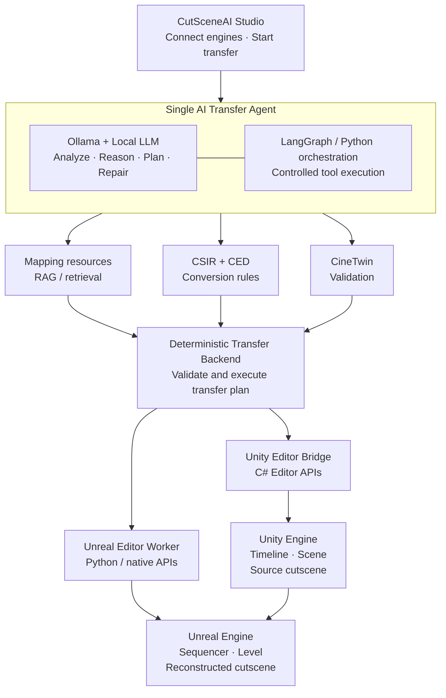

# CutScene Studio — Living Development Context

Last updated: 2026-11-26. This is the canonical handoff for the **new standalone repository**, not the earlier AI-agent research Studio.

## 1. Start here in every new chat

1. Read this file and root [AGENTS.md](AGENTS.md) before proposing or making changes.
2. Verify the current GitHub repository, branch HEAD, working-tree status (when a local checkout is available), open PR and most recent CI results. Do not assume this document is newer than Git.
3. Read the relevant implementation and regression tests; continue from the first unresolved item below unless the owner requests a different task.
4. Update this file in the same commit or PR as every code, configuration, documentation, test, or workflow change. Record native test observations and decisions here as they occur, even when no implementation changes are required.
5. Push requested changes to the active branch, verify the resulting commit, and report actual test results, blockers and local steps. Do not claim an engine test was run remotely when it was not.

Resume prompt: "Read context.md and AGENTS.md from Nithin0553/CutScene-Studio on feature/deterministic-studio-v1. Verify the latest repository state, then continue from the last unresolved step."

## 2. Repository and release state

- Repository: https://github.com/Nithin0553/CutScene-Studio (public; no declared open-source license).
- Active integration branch: `feature/deterministic-studio-v1`. Default branch `main` contains initial project documentation, not the working Studio; do not tell users to clone main for the working Studio.
- Draft PR [#1](https://github.com/Nithin0553/CutScene-Studio/pull/1), targeting main. Do not merge or publish a certified release without owner approval and the acceptance evidence below.
- Original repository: `Nithin0553/CutsceneAI`; historical only. Do not change it while working on the standalone Studio.
- Exact pre-agent baseline in original repository: `3b3ef7071e4e23efefa4d1ac6c7dee3c26738153`. Selected deterministic improvements also sourced from original main snapshot `28c63e5c1eb65f499f21508b9491d7f0e9b88a5b`.
- Latest code baseline before this handoff: `9245e5b1ca467a44c03a23c28329a1fe7669a53e`. Git HEAD, not a hardcoded hash in this file, is the authoritative current revision.

## 3. Product direction and constraints

Build a reliable local Unity Timeline to Unreal Level Sequence transfer Studio. On 2026-11-26 the owner explicitly approved the single-agent Ollama + LangGraph architecture below, superseding the previous no-agent product direction. Preserve the existing deterministic execution backend as the foundation and regression baseline; no cloud API or learning/dataset collection is required. The current implementation remains deterministic until the approved integration is implemented and verified.

First release is scoped to the cinematic elements of Benchmark 001 and 002. Avoid benchmark-name-specific logic, assumptions about scene names, or fixed private paths. Use the source as authoritative. Keep the UI clean, minimal and responsive with meaningful progress animation. Do not emit unnecessary files, commit generated artifacts, overwrite existing target sequences, or restart engines repeatedly. Explicit editor approval, source asset-copy rights, backed-up target projects and guarded native execution remain required.

### Approved target architecture (mandatory; not yet integrated)

Approved by the user on 2026-11-26 from the supplied "Proposed CutSceneAI architecture" diagram. This is the sole architectural baseline for CutScene Studio. Do not introduce alternative architectures, additional agents, or change component responsibilities or connections without explicit user approval.



### Component responsibilities and interfaces

- **CutSceneAI Studio:** the user-facing interface for connecting engines and starting transfers; displays progress, diagnostics and validation results.
- **Single AI Transfer Agent:** the only AI agent. Ollama + a local LLM provide analysis, reasoning, planning and repair decisions. LangGraph / Python orchestrates controlled tool execution. Use a configurable local Ollama API (default http://localhost:11434); model choice is pending hardware and capability verification.
- **Mapping resources:** RAG / retrieval of relevant engine conversion knowledge, preferring exact component and version matches before optional semantic retrieval. Inspect prior mappings before reusing them.
- **CSIR + CED:** engine-independent cutscene representation and conversion rules/coverage. Source census can support extraction and coverage within these existing responsibilities; it is not an additional architectural layer.
- **CineTwin:** source-to-target validation and discrepancy evidence for bounded repair; validation feedback returns to the same single agent through controlled tools.
- **Deterministic Transfer Backend:** validates and executes the transfer plan using explicit conversion algorithms, schemas, job state and engine adapters. The three knowledge/validation components inform backend execution as shown in the approved diagram.
- **Unity Editor Bridge:** C# Editor APIs connect to Unity Engine and extract Timeline, scene, source cutscene, assets and capabilities.
- **Unreal Editor Worker:** Python / native APIs connect to Unreal Engine, import assets, create actors, reconstruct the Sequencer and Level, and obtain target readback.
- **Unity Engine → Unreal Engine:** the initial transfer direction. Unity contains the source cutscene; Unreal contains the reconstructed cutscene. The arrow denotes the transfer outcome, not an unmediated engine-to-engine API bypass.

### Non-negotiable implementation constraints

- Keep one Ollama-powered AI agent with LangGraph / Python orchestration. Do not substitute a multi-agent design, another orchestration architecture, or a parallel transfer pipeline without explicit approval.
- The agent selects grounded conversion strategies, invokes allowlisted tools and proposes supported repairs. Deterministic calculations, conversion, validation and editor mutations remain in the backend and engine adapters.
- Validate tool arguments and transfer plans, retain provenance, bound repair attempts, and explicitly report unsupported or partial conversions. Avoid arbitrary generated code execution and unintended changes to source projects.
- Preserve the diagram's named components and topology. Implementation details may evolve within their responsibilities; architectural changes require explicit user approval and a context.md update.
- Existing deterministic components on this feature branch must be inspected and reused where suitable; the Ollama/LangGraph integration is not yet verified.
- No runtime implementation or real-engine transfer test is implied by architecture approval.


### 2026-11-26 — Authorization regressions passed; fresh-map integration

- Owner reported all checks passed after 7f6a430 (expected 193 Python passes, 21 Node scenarios and Ruff); exact new counts/timings not separately supplied. Last full-suite baseline remains 822 passed/seven external skips. PR #1 open draft.
- Extended existing AI inspection, authorization, host/worker and UI to support the canonical fresh-map route. Read-only checks bind proposed map and observed world, reject occupied native registry/disk paths including external actor/object directories, require known clean map state and creation API. Worker repeats inspection and checks world/target immediately before existing deterministic level creation; existing scene setup checks the new map before imports. No new architecture or arbitrary level path. Dirty/unverifiable world must be saved or inspected again.
- Added nine mocked native inspector cases in test_studio_auto_scene.py, five localhost authorization/queue cases and three worker claim cases in test_studio_local_bridge.py, and one Node UI scenario. New software tests not yet run; expected ordered targeted suite 210 passes, Node 22 scenarios. Keep Unity, Unreal and Ollama closed. Native API behavior and actual map creation remain unverified.

### 2026-11-26 — 157 targeted regressions passed; explicit authorization test coverage

- Owner confirmed same ordered six-module regression: 157 passed in 64.95 s after af4c451. Both cached mock failures resolved. Node/Ruff outputs for that revision not supplied; latest confirmed Node remains 19 scenarios, last complete Python run 822 passed/seven known external skips. PR #1 open draft at af4c451 before this update.
- Added 36 parametrized Python cases in tests/studio/test_studio_local_bridge.py: seven real localhost approval boundary cases, 15 queue authorization and manifest cases, 14 actual worker-gate/claim cases using synthetic evidence and a mocked native inspector. Cover no/wrong token, wrong request/report/candidate, manual/legacy approval rejection, stale approval, changed evidence, worker/project/level changes, collision, source manifest failure/revocation, duplicate jobs, direct queue without approval, wrong job fields and exclusive consumption. Test positive queue and worker claim without calling engine mutation; existing native inspector/replay tests remain separate. The fixture explicitly supplies the tools import path for isolated test selection. Added two Node UI scenarios (21 total) for explicit user action and failed approval; strengthened previous no-native-call checks. No production code or architecture changed.
- New cases not run remotely. Expected ordered Python suite 193 passes if unchanged; expected Node 21 scenarios. Run same six-module regression and Node, Ruff on authorization/host/test files. No engine/Ollama launches. Next after successful results: safe new-map read-only preflight, model lifecycle, remaining feature adapters and bounded CineTwin repair. Existing-map execution is not native-verified.

### 2026-11-26 — Mixed-suite candidate import regression correction

- Owner ran the six-module targeted regression at bdd5b06: 155 passed, two failed in 65.07 s. Failures were test_studio_candidate_command_prepares_and_verifies_saved_ai_report (SimpleNamespace has no PreparedTransferError) and test_candidate_helper_binds_explicit_target_project (fake_prepared unexpected keyword). Both are consistent with a cached mock from test_source_only_studio_candidate_uses_hierarchy_enabled_mapping_copy, not a demonstrated AI execution or conversion failure. Source inspection confirms the source-only bridge imports studio_candidate unconditionally while that test has temporarily substituted prepared_transfer; the wrapper retains the mock as a module global after monkeypatch restores sys.modules.
- Moved studio_candidate import in tools/studio_local_bridge.py to the capture-assisted branch, the only caller of prepare_candidate. Source-only flow continues calling its existing prepared_transfer directly. Strengthened the existing hierarchy test to simulate an initially absent wrapper and assert it is not imported under the mock. No changes to conversion, immutable verification, authorization, or source/target evidence. The existing two real candidate tests remain intact.
- Correction not executed remotely. Rerun the same six modules in the same order (expected 157 passes if no other failures), followed by Node UI and Ruff. Latest confirmed full suite remains 822 passed/seven external skips. PR #1 remains draft; no workflow runs returned for bdd5b06. Comprehensive new authorization tests and new-map preflight are still pending; keep all engines and Ollama closed.

### 2026-11-26 — Explicit AI execution authorization and existing-map integration (software checkpoint)

- Resumed from da5505e81ea91a642d602dd65db064f3bdab20c2; draft PR #1 open, no current PR workflow runs or combined statuses. Read root instructions and existing host, worker, native inspector, verifier and UI/test paths. Latest owner-confirmed results remain 75 targeted Python tests and 19 UI scenarios; latest full run remains 822 passed/seven external skips.
- Added shared studio_ai_execution_auth.py: exact request/response/report/active connection/candidate/session/manifest/artifact/input bindings, 120-second freshness, current worker identity, existing-map automatic setup only. Host exposes explicit authenticated approval bound to displayed request and report digest; queue requires approval ID and revalidates after manifest checks. Worker independently verifies submitted authorization, exact active job and job fields, rejects duplicate jobs, replays native inspector and source manifest, compares fresh proof and consumes an exclusive per-candidate claim before calling existing setup/generation. UI permits explicit authorization and submission only for verified request-specific evidence, never on refresh. No extra agent or planner. This is a trusted-local-workspace consistency gate, not protection against arbitrary disk write access.
- New-map creation intentionally remains blocked for AI candidates until a dedicated read-only new-map inspection and dirty-world/collision tests are implemented. Non-automatic AI setup remains blocked. Code is not yet verified by local regression or embedded editor; do not launch engines or execute a candidate until the software tests pass. Existing evidence is unchanged. Next add/verify comprehensive authorization and queue/worker regression cases, then new-map guard, model lifecycle, feature adapters and bounded CineTwin repair. No native generation/fidelity claim.

### 2026-11-26 — Verified inspection-request workflow; handoff to next chat

- Owner confirmed targeted Python regression (test_studio_local_bridge.py, test_studio_destination_worker.py, test_studio_planner_sync.py, test_studio_project_connect_api.py): 75 passed in 45.20 s. Node command node tests/studio/test_cinematic_ui.cjs passed all 19 scenarios, including explicit read-only AI inspection, AI preparation-only, failure recovery, native errors and Home-first startup. All 17 new Python cases and the new UI scenario pass. Latest actual full suite remains 822 passed / seven external Stage 4 fixture skips; projected current full suite 865 passes / seven skips, not yet run as a whole.
- Owner requests continuation in a new chat. Stop feature development at this verified checkpoint. Read this context and AGENTS.md first in the new chat, verify current branch HEAD/draft PR #1/CI and relevant source files. Active repository Nithin0553/CutScene-Studio, branch feature/deterministic-studio-v1; do not use historical CutsceneAI or merge main. Existing D: checkout and isolated Python environments must be preserved; keep Unity, Unreal and Ollama closed during remaining software development.
- Resume at explicit candidate-specific authorization and execution-time verification integration. Preserve single Ollama/LangGraph transfer agent, deterministic backend, immutable evidence, read-only preflight and source/target/no-overwrite gates. Implement approval bound to exact verified report/request/candidate and current worker instance; enforce freshness and repeat independent evidence replay, source asset manifest verification and native destination preflight before any mutation; only then permit controlled native execution through existing backend. Address new-map support safely; current inspector supports existing staging levels only. Add regressions for stale approvals, changed evidence, wrong worker/project/level, collisions, duplicate jobs and no bypass via direct API/queue. Then complete model memory lifecycle, remaining feature adapters, bounded CineTwin repair and native end-to-end acceptance. No engine execution or fidelity claim yet.
- No production code changed for this handoff. Owner should not need to repeat the already confirmed tests solely because a chat changes.

### 2026-11-26 — 51 targeted tests passed; explicit read-only native inspection request wired to Studio

- Owner confirmed host/planner targeted suite 51 passed in 26.85 s, including 12 persisted report validation cases. Last full run 822 passed / seven external skips; projected baseline after previously tested additions 848 passes, not yet full-suite verified.
- Host now accepts authenticated POST /api/ai-native-preflight (df11c5a), bound to active AI candidate, confirmed rights, automatic setup readiness, existing loaded staging level, current worker instance/code and exact active connection/candidate bytes. It publishes a unique timestamped read-only request, invalidates previous inspection, and deduplicates a pending equivalent request. GET reports pending/failure/completed state and accepts only matching request-specific report evidence; manual report validation remains supported when no request exists.
- Unreal tick consumes only this fixed inspection request (07b01a4), checks current worker instance/code, age, no active job, and passes exact candidate/connection bindings into existing inspector. Publishes separate completion/failure response and skips already answered requests. No execution job or inference is submitted. Native worker/host execution gates unchanged. The UI AI plan view now offers Inspect target (read-only) and polls inspection status only on the AI transfer screen (6954e04); no automatic approval or execution; connect helper visible if editor unavailable.
- Added 11 HTTP request/status cases (1272f96), six worker request-consumption cases (662e797) and one Node UI scenario (a5639cd). New tests not executed remotely. Expected Python full suite 865 passes / seven known skips if unchanged; expected Node 19 scenarios. Owner fast-forward then run test_studio_local_bridge.py, test_studio_destination_worker.py, test_studio_planner_sync.py, test_studio_project_connect_api.py and node tests/studio/test_cinematic_ui.cjs. No editor launches yet. Next implement explicit candidate-specific authorization record and fresh execution-time native replay/verification, including new-map support and source asset verification before mutation. Current existing-map automatic staging only; no native end-to-end proof. PR #1 remains draft; previous HEAD had no PR workflow runs.

### 2026-11-26 — 125 targeted tests passed; persisted native preflight report validation

- Owner confirmed five-module targeted regression 125 passed in 35.97 s, including all ten newly added mock native preflight/project binding cases. Prior four bootstrap cases confirmed separately. Full-suite baseline remains 822 passed / seven known external skips; 836 was projected after those additions, not a full-suite result.
- Worker now persists explicit inspect_active_ai_candidate() results atomically to workspace ai-native-preflight.json (dd5486d, 70915e3), separate from immutable candidate artifacts. It removes previous report before a new inspection, binds original active-candidate and connection bytes, worker import-time source hash, unique worker start instance ID and check time; checks that active records did not change during inspection. Heartbeat includes the instance ID. No jobs are submitted and no engine content is mutated.
- Host exposes read-only GET /api/ai-native-preflight and validates persisted report (9dea59d): current worker protocol/source hash/root/instance, heartbeat freshness, 120-second report freshness, candidate and connection byte hashes, source rights, no active job, matching loaded project and level, exact immutable session/manifest and four artifact hashes, source/mapping/analysis/capture byte hashes and matching identities. Report is consistency evidence only, not approval or renewed scene inspection; source asset contents/native scene can still change and must be independently reverified before any future mutation. Existing deterministic readiness path, UI and execution gates unchanged. No automatic editor tick inspection or host-requested inspection/UI action yet.
- Added 12 HTTP report-validation regressions (a85f6d4) with synthetic report/heartbeat fixtures: valid, expired, restarted worker, wrong level, modified connection/candidate/session/setup/artifact/source, authorization flag, missing report. Assert no approval or job created. New tests not run remotely; next owner fast-forward and run test_studio_local_bridge.py and test_studio_planner_sync.py. Projected full suite 848 passes / seven skips if unchanged. Next implement explicit host/UI preflight request and approval bound to current verified evidence, then fresh execution-time replay/native preflight and controlled job submission. No embedded-editor tests yet; keep engines closed during code/regression checkpoints. Draft PR #1 remains open; previous HEAD returned no PR workflow runs.

### 2026-11-26 — Dependency tests passed; candidate-bound native setup preflight implemented

- Owner confirmed test_studio_planner_sync.py: 15 passed in 3.10 s, including four new dependency-bootstrap regressions. Previously verified direct bundled Unreal Python replay. Latest full suite remains 822 passes/seven external skips; four additional tests confirmed separately, not a new full-suite count.
- Added integrations/unreal/studio_ai_native_preflight.py (1e471f4), an on-demand read-only inspector for AI automatic-setup candidates in an already loaded staging level. Replays saved AI evidence and verifies setup, binds session and manifest byte hashes, rejects absent/wrong target project identity, wrong loaded project/level, occupied namespace/sequence/import paths, duplicate labels/paths, existing actor labels, missing native APIs and unsupported light classes; calls existing read-only primitive mesh bounds/class check. Returns a preliminary inspection report with no execution authorization, import readback pending, no fidelity claim. Does not create maps or actors, import assets, save evidence, submit jobs or run inference. New-map mode and non-automatic setup deliberately not supported in this first inspector.
- Added explicit worker inspect_active_ai_candidate() (fd097d9), validating active candidate directory, source rights, source/mapping/sequence identity and unchanged connection before returning preliminary inspection; never called each tick, never queues work. Host/UI and worker AI execution guards remain closed. Existing deterministic destination inspection unchanged.
- Added optional target_project to tools/studio_candidate.py (26321a3) and propagated it for capture-assisted AI preparation from host (778bfb4). Previously capture-assisted wrapper did not bind target project; old unbound candidates must be newly prepared rather than edited. Legacy default unchanged.
- Added nine mock native preflight cases (7c95cb2) and one target identity regression (fc91e30). Tests not run remotely; no new engine acceptance. Owner should fast-forward and run test_studio_auto_scene.py, test_source_evidence.py, test_studio_candidate.py, test_studio_local_bridge.py, test_studio_planner_sync.py; expected full suite 836 passes / seven external skips if all pass. Actual expanded candidate remains preserved. Next implement persisted candidate-bound report freshness/identity and explicit host/UI approval integration; keep native execution disabled until regression and authorization checks complete, then model lifecycle/remaining adapters/CineTwin bounded repair. Do not launch engines yet. PR #1 draft; prior HEAD no PR workflow runs.

### 2026-11-26 — Automatic dependency discovery verified in actual Unreal bundled Python

- Owner supplied direct verifier output with no manual dependency path configuration: AI_EVIDENCE_REPLAY_VERIFIED under UE bundled CPython 3.11.8. Identical session 33c2df7eb818ad86a5a6, source/analysis and all four artifact hashes, 17 canonical modules, five attributed proposals, two unsupported, zero failed/not analyzed, 21 backend actions, verified automatic setup with 11 actors, five imports and seven Cube references. All execution/fidelity flags false. This confirms standalone automatic bootstrap on the installed runtime, not editor-embedded compatibility.
- Four newly added bootstrap regression results still not supplied. Last confirmed full baseline 822 passed / seven external Stage 4 skips; expected 826 if unchanged. Next confirm targeted test_studio_planner_sync.py, then implement candidate-bound embedded-editor read-only preflight and explicit native authorization integration. Retain preparation-only gates until tested. No application code changes in this checkpoint; no editor or model launch needed.

### 2026-11-26 — 822-test baseline passed; automatic local AI dependency bootstrap

- Owner confirmed full Windows regression after HTTP correction: 822 passed, seven known external Stage 4 fixture skips, zero failures in 135.02 s. Eight verifier cases and two new HTTP cases pass. This is the latest confirmed clean Python baseline; earlier Node baseline 18 scenarios. Cross-runtime saved candidate replay previously passed under Studio Python 3.12.10 and UE bundled Python 3.11.8.
- Reviewed current Unreal worker start, UI command and Studio launcher. AI verification already calls synchronize_ai in both the independent verifier and worker; no UI path configuration needed. Added configure_ai_dependencies to integrations/unreal/studio_planner_sync.py (3038b1a): first respects available jsonschema, otherwise discovers the previously provisioned runtime-dependencies/unreal-python311 folder beside checkout for 64-bit Windows CPython 3.11 only. It does not install, download, write or consult candidate-supplied dependency paths. It refuses cached core dependencies outside the isolated bundle before activating it and verifies resolved schema module origin. Ordinary deterministic planner sync does not invoke this bootstrap. Missing/broken/incompatible dependencies fail closed; existing interpreter packages remain unchanged. Native AI worker authorization remains disabled.
- Added four isolated subprocess bootstrap regressions (f85a4de): existing dependency, local bundle and repeated configuration, empty bundle, cached foreign dependency. Tests simulate bundle lookup; actual engine Python check still required. No new test execution remotely; expected 826 passes / seven skips if unchanged. Owner fast-forward, run test_studio_planner_sync.py and replay the preserved expanded candidate directly via UE bundled python -I -B integrations/unreal/studio_ai_verifier.py --candidate <expanded> --require-setup, without manual sys.path insertion or reinstall. Verify five attributed proposals, 21 actions, 11 actors, five imports, seven cube references and no native changes. Then continue with candidate-bound embedded-editor read-only preflight and authorization, model lifecycle and bounded CineTwin repair. Draft PR #1 remains open, previous HEAD had no PR-triggered workflow runs.

### 2026-11-26 — Windows localhost HTTP rejection regression correction

- Owner full regression after independent verifier additions: 819 passed, one failed, seven original external Stage 4 skips in 130.55 s. All eight new replay tests passed; sole failure tests/studio/test_studio_project_connect_api.py::test_discover_connect_local_project_folders. Unauthorized POST /api/pick-folder logged HTTP 403 on server, but Windows client raised ConnectionAbortedError WinError 10053 before reading the response.
- Inspected host handler: token/origin rejection returned before consuming request body. Closing TCP with unread request bytes is a plausible Windows reset cause (not proven by a socket trace). Corrected tools/studio_local_bridge.py (57956d5) to check authorization but read only well-framed bounded bodies before responding; no JSON decoding/route dispatch without valid origin and token. Retains 64 KiB cap, rejects ambiguous duplicate Content-Length and Transfer-Encoding, uses a five-second socket read timeout, rejects incomplete bodies. Invalid framing/oversize may return 400/413 before authorization; no unrestricted draining, retry masking or security bypass.
- Added two regression tests (0d28c10) for maximum-size malformed unauthorized bodies, wrong token and foreign origin with complete 403 responses/no picker invocation or workspace mutation, and early rejection of oversized/ambiguous/unsupported framing. Windows verification pending; no new tests executed remotely. Owner should run targeted HTTP tests, then full suite (expected 822 passes / seven skips if unchanged). Previous confirmed clean baseline 812 passes, seven skips; cross-runtime replay remains verified. Native authorization gate remains closed. No engine/model launches required. PR #1 remains draft, prior head had no PR-triggered workflow runs.

### 2026-11-26 — Cross-runtime AI evidence replay verified using Unreal bundled Python

- Owner supplied successful AI_EVIDENCE_REPLAY_VERIFIED output using actual UE 5.8.3 bundled CPython 3.11.8 executable, after adding isolated D: runtime-dependencies/unreal-python311 to sys.path. Same session 33c2df7eb818ad86a5a6, raw source and analysis hashes, all four artifact hashes, 17 canonical module names, five proposed/five attributed, two unsupported, zero failed/not analyzed, 21 actions, 11 actors, five imports, seven native Cube references and verified setup as prior isolated Studio Python 3.12.10 replay. Execution authorization, engine generation and behavioral fidelity remain false. This verifies bundled interpreter compatibility outside the editor; no embedded-editor proof, native mutations or inference.
- Next confirm eight verifier regression cases/full suite (last confirmed 812 passes / seven external skips; expected 820 passes if unchanged). Then implement explicit D: dependency bootstrap for embedded worker, read-only native replay/preflight, candidate-bound approval and execution integration, retaining existing gates and no shared model forced unload. Do not treat standalone runtime success as native acceptance. No production code changes in this checkpoint.

### 2026-11-26 — Unreal bundled Python dependency gap identified

- Owner confirmed UE 5.8.3 bundled Python executable exists, CPython 3.11.8, 64-bit. Isolated -I -B import of jsonschema failed with ModuleNotFoundError; Studio host venv is Python 3.12.10. No Unreal replay yet.
- Install jsonschema and compatible dependencies only into a fresh D: runtime dependency directory using host pip with explicit Windows amd64 / CPython 3.11 wheel tags, no global installation, no bytecode compilation and no pip cache. Prefer the same jsonschema version as the verified Studio environment. Explicitly prepend that directory in the bundled interpreter for a read-only import probe and verifier replay; -I ignores PYTHONPATH. Do not copy the host venv site-packages, alter engine installation, or launch editor. If installation/import fails, retain diagnostic output and do not enable native execution. Embedded interpreter dependency configuration and worker authorization still pending. No application code changes.

### 2026-11-26 — Installed Unreal runtime located

- Owner confirmed Epic Launcher installation manifest lists UE_5.8, release 5.8.3-58210709, installed on the required D: drive. Old Unreal 4.0 registry entry is not the target runtime.
- Next check the installed engine's Engine/Binaries/ThirdParty/Python3/Win64/python.exe existence, version, architecture and jsonschema availability, without launching Unreal. If available, replay the preserved expanded candidate using that executable; otherwise isolate compatible dependencies on D: before replay. No installation, editor launch, execution authorization or application code changes at this checkpoint. New targeted regression results still outstanding.

### 2026-11-26 — Independent expanded candidate replay passed in isolated Studio Python

- Owner supplied verifier JSON: AI_EVIDENCE_REPLAY_VERIFIED, session 33c2df7eb818ad86a5a6, raw source SHA256 9639d6410ca16bd2f0c18ed44ae9cb1fee77699caf6bfb53992365d426368e7b, analysis SHA256 dd8ac47d3c39619528bde770ad08960b2881f629b3c5ab63c6f3c7dc2f5b9b01; four artifact hashes verified, five proposed/five attributed, two unsupported, zero failed/not analyzed, 21 actions, automatic setup verified with 11 actors/five imports/seven native Cube references. All execution and fidelity flags false. 17 canonical module names reported; Python 3.12.10 in existing D: .venv-studio under isolated -I -B command. No native editor interpreter tested yet.
- Owner has not supplied the new targeted regression results; latest confirmed full suite remains 812 passed / seven known external skips, plus 18 Node scenarios. Next locate installed Unreal Engine Python executable and check Python version and jsonschema import without editor launch. If dependency absent, use an isolated D: target directory for matching interpreter dependencies, not global install or copying incompatible venv binaries. Replay exact expanded candidate with actual engine-bundled Python outside the editor; embedded-editor verification and native authorization remain separate. No production changes in this checkpoint.

### 2026-11-26 — Independent AI replay verifier and native worker gate

- Added canonical qualified-module synchronization in integrations/unreal/studio_planner_sync.py (273e7ed). Refreshes packages.studio CED/catalog, provider types, transfer-agent types, retrieval and source-evidence modules in dependency order, rejects foreign or mixed namespace packages and shadowed cached modules, checks Draft202012Validator availability, and checks module resolution before loading. The existing bare deterministic synchronization remains separately callable without requiring AI dependencies. No LangGraph graph construction or Ollama inference is needed for replay.
- Added integrations/unreal/studio_ai_verifier.py (4f4ee47, 04fac8f), read-only CLI/API. Independently replays prepared_transfer.verify with canonical modules, checks AI attachment/proposal attribution and rechecks handoff artifact hash before summarizing, optionally requires and recomputes automatic setup manifest, reports counts and runtime identity. Never writes candidate artifacts, submits a job, calls Unreal, or authorizes execution. Replay is evidence consistency, not model authenticity, native validation or fidelity certification.
- Worker independently refreshes AI modules for an attached analysis and runs prepared_transfer.verify before explicitly refusing native AI execution (1e11575). Host/UI preparation-only gate unchanged. Deterministic worker path retains prior behavior.
- Eight new regression cases (a25fb56, 0ea013b): four isolated-process replay cases (valid with network/engine/LangGraph imports forbidden, modified handoff, legacy non-AI candidate, missing required setup), three synchronization cases (stale qualified module, shadowed module, unavailable jsonschema), and worker pre-mutation ordering check. New tests not executed here; latest owner-confirmed baseline remains 812 passed / seven known external skips, 18 Node scenarios. No new native engine validation. Expected 820 passes if collection unchanged and tests pass.
- Next: owner fast-forward active branch, run new targeted tests and independent CLI against preserved expanded candidate with --require-setup in existing D: venv using -I -B. Expect five attributed proposals, 21 actions, 11 planned actors, five imports, seven Cube references, all execution/fidelity flags false. Then identify actual Unreal Python interpreter and verify dependency/runtime compatibility without opening editor or installing into C:; only after that integrate explicit native authorization and bounded repair. Do not overwrite old evidence, unload a shared model blindly, or bypass any preflight gate. Draft PR #1 open; prior HEAD returned no PR workflow runs.

### 2026-11-26 — Expanded immutable scene candidate and 812-test baseline passed

- Owner confirmed expanded Benchmark001 candidate: immutable replay true, automatic setup manifest verification true, 11 planned actors, five imports, ready true, zero blockers. Seven source-identified Cube mesh references, two camera actors, character root and Directional Light. 21 actions: transform 10, camera_setup 2, camera_cut 2, camera_fov 1, skeletal_animation 1, audio 1, marker 1, property_float 2, property_bool 1. Compared with prior live 13 actions: seven additional transforms and one Boolean property. No engine mutation performed. Nine entities without independent bindings remain explicit (seven character renderers, hierarchy group, audio source); native geometry, materials, lighting, collision, skeleton and audio behavior unverified. Unity .mat/URP/sky/ambient and AudioListener limitations remain.
- Owner full regression: 812 passed, 7 skipped in 128.89 s; all seven are original external Stage 4 evidence fixtures. No failures. This confirms all eight new static actor/Cube test cases with the existing automated suite; Node baseline 18 scenarios previously confirmed. No application changes in this checkpoint.
- Reviewed studio_planner_sync.py and AI replay dependencies: native sync currently prioritizes bare planner module paths, but AI handoff replay imports qualified packages.studio modules and requires jsonschema. LangGraph import is lazy and no inference is needed to replay decisions. Next add a read-only verifier entrypoint with explicit canonical repository package paths, dependency checks and separate AI replay refresh, then test with the same expanded candidate using a fresh Python process. Do not enable host/UI native execution until verification and authorization integration are tested; do not launch editors or write to source projects in this checkpoint. Draft PR #1 remains open; no PR workflow runs returned for prior HEAD.

### 2026-11-26 — Actual expanded scene mapping validated

- Owner confirmed read-only discovery against actual Benchmark001: 20 source entities, 11 mapped actors (character root, both Timeline cameras, moving prop, six static environment props, Directional Light), seven exact built-in Cube mappings. No independent character renderer duplicates; no editor changes. This verifies the source classification milestone, not native staging or fidelity.
- Targeted regression output for the eight new cases has not been supplied; last full verified baseline is 804 passed / seven known external Stage 4 skips. Run targeted discovery, automatic assets, automatic scene and bridge suite, then full suite (expected 812 passes / seven skips if unchanged).
- Next verify expanded immutable candidate and automatic setup manifest in a new D: run directory by retaining the prior live mapping's census/hierarchy/asset options, substituting regenerated scene bindings, assigning a fresh destination sequence and replaying saved AI analysis (plus original capture if present). Verify original candidate before deriving new inputs; verify new candidate and regenerated setup manifest. Never overwrite previous mapping or publish a native job. Expect 11 planned actors, seven native Cube specs, five attributed AI proposals if no new preflight issue; exact action/import count may change due to light and adaptive component planning. Native execution gate remains closed. No production code changed; PR #1 open draft, no previous-head PR workflow results returned.

### 2026-11-26 — Actual source/candidate files verified; static actor and Cube staging implemented

- Inspected all four owner-uploaded files (original Benchmark001 CSIR, live ai-handoff, coverage and generated mapping). Canonical source SHA-256 matches prior analysis (2324a760d692db16b894545b3840ca599748f9e22c2699aa6c1b48ac964f7c1b); raw CSIR and mapping hashes match backend_evidence; handoff actions and CED report equal coverage. All five proposed track routes attributed, two withheld tracks audio and marker separately accounted, seven tracks NATIVE_UNVERIFIED, execution and behavioral fidelity false. Backend CED 179 partial and 60 supported-unverified; source analysis previously 186 alerts includes missing mapping findings. Uploaded evidence confirms four current actor bindings and 13 actions, not complete scene transfer. Full session/manifest/source census files not uploaded; full immutable recomposition not repeated here.
- Actual source entities: one character root and seven character renderer children (same FBX), two Timeline cameras, moving prop plus six environment props (all seven exact Unity built-in Cube identities: Library/unity default resources, GUID 0000000000000000e000000000000000, mesh_name Cube, renderer_path equals own hierarchy_path), one Directional Light, one ENVIRONMENT grouping container, one AUDIO_SOURCE. Container aggregate renderer records must not cause duplicate geometry. Expected independent scene actor count 11, not 20. No benchmark object-name hardcoding.
- Implemented shared direct renderer ownership / built-in Cube identity helpers (f3a1d34), conservative source-driven static actor selection (97acfc2) for active independently owned single mesh with exact project FBX or known Cube and typed active lights; exclude character descendants, mapped-owner descendants, unknown/inactive ancestors and aggregate containers. Existing Timeline-bound/legacy attached-prop selection retained, including inactive cameras controlled by Timeline. New discovery mapping content participates in file identity so prior mappings remain immutable. Unresolved geometry and unsupported lights remain explicit gaps.
- Added Cube asset planning (2fac343): fixed allowlisted Unreal engine mesh /Engine/BasicShapes/Cube.Cube, no FBX import, source identity evidence and native verification warning. Native automatic scene staging (8b69143) resolves only allowlisted engine mesh, checks StaticMesh class/path and centered 100 cm bounds via Unreal StaticMesh.get_bounds (documented Unreal Python API), spawns through existing mesh-object path, verifies spawned component mesh, does not apply material restoration to engine-owned primitives. Editor worker checks primitive dependencies before destination level creation (7ba0d12). Native API availability, actual mesh dimensions, visual/material/collision parity, and lighting behavior still require Unreal verification. No engine asset edits, new architecture, or removal of AI execution gate.
- Added eight regression cases: source-driven static selection/immutable mapping (9c84e38), four mocked native Cube preflight variants plus three identity rejection variants (0e5210a). New code/tests not run in owner's environment or CI here; sandbox GitHub DNS unavailable, so cannot clone/run whole repository from this turn. Expected full baseline 812 passed / seven external skips if collection unchanged. Run targeted discovery, automatic asset/scene, source identity and host tests, then full pytest. Confirm 11 bindings and seven Cube actor specs from actual source in fresh candidate; preserve existing run artifacts and use a fresh workspace/mapping. No native launch/inference necessary for mapping inspection or mock tests. Remaining native verifier, resource lifecycle, partial fidelity and CineTwin repair outstanding.

### 2026-11-26 — Live action count difference confirmed; source classification evidence required

- Owner provided live plan action listing and generated mapping. Exactly four bindings: CAM_A_Wide, CAM_B_Close, CHARACTER_Guard, MOVING_PROP. Live action counts camera_setup 2, skeletal_animation 1, transform 3, camera_cut 2, camera_fov 1, audio 1, marker 1, property_float 2 = 13. Three transforms are moving prop, camera B animation, camera A static pose. Two float actions are URP camera post-process enable for cameras A/B. Compared with previous example mapping plan: six fewer transforms and two additional float actions (17-6+2=13); other action counts unchanged. No native equivalence inferred.
- Inspected UnityTimelineExtractor.cs and ExtractorUtilities.cs: non-camera/light/audio/rig objects default to entity.prop; hasCharacterRig and renderer model/material asset extraction inspect descendants, so neither entity.prop nor presence of model/material records alone establishes independent scene actor ownership. tools/studio_auto_assets.py resolves FBX identity for props or produces explicit transform-only warning; no verified primitive mesh adapter established by these inspections. Do not blindly map every prop/rig child or invent geometry from names. _source_mapping currently limits independent bindings to active track-bound actor types and attached child props, whereas manual mapping includes six environment actors.
- Next inspect original actual CSIR entity metadata and hierarchy, live coverage-report, ai-handoff and mapping, preferably upload those JSON files or provide read-only structured summary, before implementing safe general environment binding/geometry strategy. Preserve existing immutable candidate and prior source exports; no Ollama or native engine launch needed. No application code changed; native execution remains blocked. Draft PR #1 remains open, no previous-head PR workflow runs returned. Last confirmed automated baseline 804 Python passes / 7 external skips and 18 Node scenarios.

### 2026-11-26 — Live automatic setup evidence and scene binding limitation

- Owner confirmed active-job.json absent in isolated live workspace and supplied automatic_setup: available true, ready true, blockers empty, five planned imports, four planned actors. Warnings: 16 source entities lack independent target actor bindings; basic embedded FBX materials only, Unity .mat/shader graphs/URP/sky/ambient unmapped; MOVING_PROP mesh identity not found (transform-only); URP runtime Lit.mat unresolved (UNSUPPORTED_OR_UNSAFE_SOURCE_PATH); target skeletons/materials/animation remain unverified. No actual imports or actors created.
- Inspected tools/studio_project_discovery.py _source_mapping: discovery selects active track-bound character/camera/prop/light entities and directly attached child props, not the whole scene. The earlier Benchmark001 example mapping explicitly binds ten named actors including Floor, four walls and Landmark_Pillar. This explains why the discovery path can have fewer environment bindings; precise 13 vs 17 action difference still requires actual plan comparison. Unmapped source entities may include component/rig children, so do not promote every entity into an independent actor or claim 20% fidelity. Next inspect live session/plan/coverage/handoff/mapping and source entity identities with read-only commands; then address safe source-grounded scene reconstruction alongside native verifier integration. No application changes; native execution gate remains closed.

### 2026-11-26 — Live Studio AI preparation succeeded in explicit best-effort mode

- Owner supplied actual Studio screenshot showing AI_PREPARED, Source analysis and verified candidate: five proposed mappings, two withheld, failed/not analyzed 0/0, 13 planned actions, 186 active source CED alerts, ten partial native source snapshots. Native AI verifier integration pending; no native changes performed, fidelity unverified. The preceding strict census block identified two AudioListener components; best-effort preparation retains these limitations. This confirms live UI/host/model preparation at the screenshot level; raw candidate artifacts not yet inspected.
- Action count differs from previous 17-action example-mapping baseline. Inspect live active-candidate record, session, transfer-plan, coverage-report, evidence, ai-handoff and copied mapping before deciding why. UI-generated bindings, optional capture/hierarchy/adaptive options can differ; do not assume exactly four missing features from action count alone. Confirm source digest and five exact proposal attributions and preserve missing source findings; no native job should exist. Request read-only summary or actual JSON artifacts from isolated D: workspace. No application changes in this checkpoint. Latest Python 804 passed / 7 known external skips, Node 18 scenarios passed; Ruff after earlier cleanup not explicitly supplied.
- Next native verifier integration must check canonical module origin and available dependencies, preserve immutable verification and existing approval/preflight/non-overwrite gates; model lifecycle and bounded CineTwin repair remain outstanding. Do not launch native engines for current evidence inspection.

### 2026-11-26 — Live Studio strict source census blocked before AI inference

- Owner supplied screenshot of the actual Studio AI preparation screen. Strict source census blocked two component/scope findings: UnityEngine.AudioListener on CAM_A_Wide and CAM_B_Close, each NATIVE_COMPONENT_EXTRACTION_OR_ADAPTER_REQUIRED. Ten native source snapshots are recorded as partial (collision, URP and signal behavior Unreal-unverified). UI explicitly reports no Unreal assets modified and offers Prepare supported parts, confirming AI mode is selected. No model inference or candidate preparation success established yet.
- For the current preparation-only milestone, owner may explicitly choose Prepare supported parts after reviewing these findings; preserve both missing AudioListener entries and partial snapshots as limitations. Do not suppress census checks or claim listener equivalence. AudioListener source extraction and target behavioral adapter/validation remain future fidelity work. No application code changed. Next inspect live AI preparation result or exact error and saved report; native execution remains blocked. Full Python baseline 804 passed / 7 known external skips, UI 18 scenarios passed.

### 2026-11-26 — All 18 cinematic UI regression scenarios passed

- Owner confirmed the corrected Node mock-backend suite passed all 18 scenarios, including AI preparation-only, explicit fresh deterministic recovery, no replay, failure handling, native errors and Home-first startup. Latest Python baseline remains 804 passed / seven known external Stage 4 skips. Post-correction Ruff output not explicitly supplied. No application changes in this checkpoint.
- Reviewed tools/start_studio.ps1, studio_project_discovery.py and studio_ui_features.py for live preparation. Next use an isolated D: storage root with the existing checkout/venv and an unused localhost port; run the existing Ollama model on its D: model store, close Unity/Unreal during inference, connect real saved Unity and backed-up Unreal project folders through UI, select the previously analyzed Benchmark001 CSIR and matching Source Census. Native AI approval/queue remain blocked. Do not bypass identity or strict census; explicitly review partial findings before any best-effort preparation. If matching exports are missing, stop and record blocker rather than fabricate data. Generated discovery mapping, optional capture and hierarchy options can change plan counts versus the 17-action example-mapping baseline; compare proposal attribution and session hashes rather than assume identical counts.
- Live UI/host inference is still unverified. Retain source-analysis report and candidate evidence on D: outside Git. After successful live preparation, verify native interpreter dependencies and canonical imports before changing execution gate, then model lifecycle and bounded CineTwin repair. Draft PR #1 remains open; no prior-head PR workflow runs returned.

### 2026-11-26 — Restored AI UI regression polling correction

- Owner reported Node assertion failure in testRestoredAIPlanNeverAutoQueues, line 525, expected one /api/execute call but observed zero after explicitly switching to a fresh deterministic candidate. Inspected current cinematic.js and harness: start() invokes advance() while action holds busy, so actual submission is deferred to next status poll, as in existing deterministic and restored-pending tests. The new test omitted that poll. No application/native execution failure established by this mock test.
- Corrected test sequencing (4e5dda7): assert exactly one reconnect, preparation and approval for the fresh deterministic candidate, poll before expecting execution, check exact new candidate ID and approval-before-execution order, then poll again and ensure no replay. Existing no-native-call assertions for restored AI candidate remain. No production code or approval/readiness safeguards changed.
- Next: fetch/fast-forward and rerun node --check apps/studio-web/cinematic.js and node tests/studio/test_cinematic_ui.cjs; expect 18 scenarios passing. Corrected suite not run here. Full Python baseline remains 804 passed / 7 known external Stage 4 skips. Previous corrected Ruff result not supplied. Live host/UI analysis and native verifier integration remain pending. Draft PR #1 remains open; no previous head PR workflow runs returned.

### 2026-11-26 — Full 804-test baseline restored; cinematic UI AI opt-in

- Owner reported targeted 90 passed in 20.87 s and full 804 passed, 7 skipped in 118.36 s. All skips are the original external Stage 4 benchmark fixtures; no new skip or failure. This verifies mixed-suite planner resolution and host regression including AI preparation with mocked inference. Post-cleanup Ruff output was not supplied, so lint is not certified yet. Actual live host inference remains unverified.
- Updated default cinematic UI (5ecc79b): explicit Enable AI Agent (local Ollama) checkbox defaults off; existing source selection, rights and census constraints preserved. Enabled mode sends enable_ai_agent=true to existing /api/prepare, shows honest indeterminate analysis progress, then a preparation-only AI plan report with proposal/withheld/failure counts, actions and CED alerts. Stops before approval and execution, including restored candidates, polling and explicit partial-source recovery. Home-first startup retained with View AI Plan access; new plan/transfer requires explicit fresh candidate. Missing AI evidence or model error blocks, never silently falls back. Existing deterministic one-click path preserved when off. Advanced research UI remains unchanged. Native AI execution gates still in host; no engine mutation or architecture change.
- Updated dependency-free Node mock-backend harness (97f5672) from 14 to 18 scenarios including AI successful plan, restore with stale approval and explicit fresh deterministic transfer, failed/missing AI response, and best-effort AI still preparation-only. Existing default-off test now asserts the toggle and explicit false option. These JS checks have not been run here; run node --check apps/studio-web/cinematic.js and node tests/studio/test_cinematic_ui.cjs. Re-run Ruff on previously changed host modules if not already done.
- Next unresolved: live host/UI preparation with actual Benchmark001 using a separate D: workspace or approved existing connection, local Ollama service and existing model only, no native execution. Verify exact native replay dependencies and checkout before enabling native AI transfer. Remaining lifecycle, partial conversion, CineTwin repair and native acceptance are not complete. Draft PR #1 remains open; no PR workflow runs returned for prior head.

### 2026-11-26 — Mixed-suite import collision and host lint correction

- Owner reported 60 passed, 27 failed in 19.42 s for the five-module host integration suite. All 27 failures were AttributeError on the bare transfer_backend module (missing compose_files, compose_ai_handoff, inspect_ai_handoff, TransferBackendError), including previously passing deterministic tests. Inspected repository: tools/transfer_backend.py is a CLI with the same basename; tests/test_one_click_cinematic.py (under tests/studio) adds tools before packages/studio during collection; studio_candidate previously skipped moving already-present directories, so the CLI can be imported and cached instead of the planner. This is the identified import-order defect; actual local module origin was not printed in the supplied traceback.
- Fixed Studio candidate path ordering (e132cb2) to prioritize canonical planner even when its directory already exists in sys.path. Prepared transfer also prioritizes its own directory and rejects an already-cached module from another path rather than silently replacing it (dac702e). No converter or evidence-verification algorithm changed.
- Owner Ruff output: ten findings in tools/studio_local_bridge.py. Corrected three invalid-type exceptions to TypeError (POST handler and relevant read/error handlers preserve controlled responses), five datetime.UTC aliases and two redundant ISO Z replacements for Python >=3.11 (b78c71f); adjusted invalid AI toggle assertion (dff683a). No bulk unsafe autofix.
- Added subprocess regressions for tools-first resolution and cached shadow rejection (d5f1fc9), plus local HTTP invalid toggle/non-object body returning 422 (e530c7b). New fixes/tests not run here. Expected exact prior mixed suite plus three tests: 90 passed; expected full collection 804 passes and seven known external Stage 4 skips, assuming no other changes. Rerun original test ordering rather than avoiding conflicting modules, then full regression. Include prepared_transfer in Ruff. No live model/engine necessary. UI integration and native AI execution remain pending; existing host guards remain intact. Draft PR #1 open, no previous head workflow results returned.

### 2026-11-26 — Real Studio CLI verified; optional host AI preparation wired

- Owner confirmed post-cleanup targeted pytest 121 passed in 6.88 s. Actual Studio candidate CLI succeeded with session 9465d761fb547850e580, all seven native-unverified tracks, attached AI evidence, four verified artifacts, immutable verification passed, no generation, fidelity unverified. Generated candidate and mapping outside Git on D:. No explicit post-cleanup Ruff output supplied. Last full regression remains 787 passed / 7 external evidence skips.
- Inspected current local bridge, UI option validator, cinematic workflow and agent/provider. Added explicit Boolean enable_ai_agent option to existing /api/prepare host path (858f67e), default off; stripped from native mapping overrides, existing source/census/active-job checks still apply. When enabled, validates CSIR, checks local default Ollama model, runs one existing TransferAgent graph across the source, writes exclusive per-candidate source-analysis JSON on workspace drive, fails before candidate preparation on failed/unprocessed analysis (retains report), then attaches analysis to existing immutable preparation for capture and source-only routes. Verifies finished candidate before publishing active record with advisory counts and execution_enabled false. Approval and queue endpoints block AI candidates pending native verifier readiness. Existing deterministic path unchanged when disabled. Uses existing two-minute Ollama idle keep-alive; no forced unload of shared models. No extra agent, no native execution, no new remote service.
- Four additional regression cases (335649b) in tests/studio/test_source_evidence.py exercise host preparation with real planner and mock inference, immutable report attachment and approval/queue gate, failed inference evidence retention, disabled and invalid opt-in. New code/tests not executed here; expected full suite 801 passes / 7 known skips if unchanged. Draft PR #1 remains open; no PR workflow runs returned for previous head.
- Next: local targeted tests including local bridge and one-click workflow, lint (legacy bridge lint issues may be pre-existing), then live host preparation on a separate D: workspace using actual CSIR and existing valid target project/mapping connection, no native queue. UI checkbox and explicit preparation-only UX still pending; do not automatically approve/execute AI candidate in current one-click UI. Native verifier dependency/origin validation, model lifecycle, partial fidelity and bounded CineTwin repair remain outstanding.

### 2026-11-26 — 121 targeted tests passed; candidate command lint cleanup

- Owner confirmed 121 targeted tests passed in 6.76 s, including immutable AI preparation, tamper rejection and Studio candidate command regression cases. Ruff reported only TRY203 in tools/studio_candidate.py (redundant catch-and-reraise). Removed the redundant handler (3248104), retaining exclusive file creation, error propagation and failed-trial evidence; no conversion or verification logic changed. Post-cleanup tests and Ruff remain to be rerun.
- Next: fast-forward the existing branch, repeat targeted tests and Ruff, run actual saved Benchmark001 analysis through the new Studio candidate CLI with a fresh destination and output directory on D:. Native worker dependency validation, host/UI integration, model lifecycle and repair remain pending. Full suite last confirmed at 787 passed / 7 external Stage 4 skips before ten new regression cases. No engine launches or Ollama inference needed for CLI validation.

### 2026-11-26 — Actual AI candidate verified; Studio candidate command accepts saved analysis

- Owner supplied actual Benchmark001 candidate console output: session c95847b5f522c2478da4, AWAITING_UNREAL_PREFLIGHT, ai_analysis attached, immutable verify returned identical session, four artifact hashes verified (transfer-plan, coverage-report, evidence, ai-handoff), five proposed and two withheld, zero failed/unanalysed, 17 backend actions unchanged. Execution authorized false, generation executed false, fidelity established false. Fresh candidate and mapping on D: outside Git. Only console evidence inspected; native target unverified. Eight new immutable regression tests and Ruff not explicitly reported yet; last full confirmed baseline 787 passed / 7 external evidence skips.
- Inspected Studio candidate wrapper, local bridge preparation and editor planner sync. Extended existing tools/studio_candidate.py (003cdd5) to accept optional --analysis and optional --capture, add repository root for namespace imports, preserve exclusive fresh mapping/candidate creation, reject missing supplied evidence and root-world-lock without capture, reuse prepared_transfer.prepare, and verify the finished candidate in the CLI before reporting success. Existing capture-based function calls remain supported. No alternate planning pipeline or engine calls. Added two regression cases (54a62ed) in tests/studio/test_source_evidence.py: real wrapper CLI argument flow with saved synthetic AI evidence and guard against root-lock without capture. Expected full count 797 passes / 7 known external skips if unchanged. New changes not run here.
- Next run targeted tests including test_studio_candidate.py and test_prepared_transfer.py, Ruff changed modules, and actual saved B001 report through the new CLI with fresh sequence/mapping/candidate on D:. Then wire optional AI into host/UI preparation, test exact native verifier dependency availability before native job enablement; current UI and Unreal worker remain unchanged. The embedded Unreal interpreter may need jsonschema and canonical package origin handling; avoid requiring Ollama/LangGraph for replay or weakening validation. No engine start/inference needed for current command validation. Draft PR #1 open, no previous head PR workflow results returned.

### 2026-11-26 — Full regression passed; optional immutable AI candidate preparation added

- Owner confirmed full pytest: 787 passed, 7 skipped in 116.92 s. All seven skips remain the original unavailable external Stage 4 evidence fixtures (tests/test_studio_audit_stage4_layout.py:30). Changed backend and feature-dispatch Ruff checks passed. This validates source-attribution fixes and the complete automated baseline before this checkpoint; no native acceptance inferred.
- Reused validated backend handoff composition (9ee3534), preserving inspect_ai_handoff API and returning the same plan/coverage/evidence plus advisory inspection for preparation. Added optional analysis_path to prepared_transfer.prepare (7fd4898), binding the original analysis file byte hash to the session ID, adding ai-handoff.json to the exact artifact manifest, replaying source-eligible choices without inference on verify, and requiring every proposed mapping to have a matching attributed backend action. Unsupported tracks remain explicitly accounted for as advisory best-effort gaps. Existing strict CED gate remains independent. Deterministic-only sessions retain existing identity/three artifacts and do not require AI modules. Source/mapping/capture byte hashes now checked against composed evidence and initial hashes before creating output (79a45e6). No native execution, action values, mapping policy, or overwrite permission changed.
- Added eight regression cases (2a5e7d4; shared fixture isolated in 55f21fa): AI/legacy identical deterministic artifacts and distinct session IDs, altered analysis bytes, modified inspection with and without manifest rehash, detached attachment, missing manifest entry, unmatched proposed action, invalid analysis before output. New code/tests not run here. Expected full suite 795 passed / 7 external skips if no other changes. Draft PR #1 open, no workflow runs returned for previous head.
- Next: local targeted tests and Ruff, then prepare/verify a fresh read-only candidate on D: using the selected existing actual Benchmark001 CSIR and saved analysis report and a fresh sequence path in a copied example mapping. Example target remains unverified. No Ollama inference or editor launches needed. Keep generated candidate outside Git; do not submit to Unreal. Studio UI/config/candidate wrapper integration and native worker import/dependency verification remain pending: the optional replay imports repository packages and jsonschema, so confirm exact checkout/root and Unreal Python dependency availability before enabling this feature in native execution. Do not weaken verification to bypass dependency errors. Subsequent work: UI wiring, local model lifecycle, partial conversion/fidelity, CineTwin repair, native acceptance.

### 2026-11-26 — Corrected Benchmark001 handoff passed all five attribution checks

- Owner reran actual read-only handoff after source_track_id changes: five AI proposals, two withheld, zero failed/unanalysed; same 17 action counts (camera_setup 2, skeletal_animation 1, transform 9, camera_cut 2, camera_fov 1, audio 1, marker 1). All five proposed routes are now attributed to their actual source track; audio and marker also attributed while strict AI policy withholds both due to partial fidelity. Seven backend tracks NATIVE_UNVERIFIED, execution_authorized false, fidelity false. No native engine changes. Evidence from owner console output; new report file not inspected directly.
- Automated results for the three newly added attribution cases and updated lint were not supplied. Previous confirmed 97 tests and Ruff pass predate this metadata change. Before adding immutable candidate integration, run Ruff for changed production files and all pytest tests on D: (expected 787 passed / 7 original external Stage 4 skips if no other changes: 764 prior full pass + eight diagnostics tests + five scene report tests + seven handoff tests + three attribution tests). Investigate any additional skips or failures; do not certify release.
- Reviewed prepared_transfer.prepare and verify: artifact manifest is exact, session identity currently binds source/mapping/capture/target, verifier recomputes deterministic plan/coverage/evidence. Next implementation should bind optional advisory AI evidence to this existing immutable flow, maintain legacy behavior when disabled and verify unchanged inputs before execution; avoid requiring an active Ollama model in verification or native runtime. No application changes in this checkpoint. Native target paths from example mapping remain unverified, as do partial fidelity, source capture/hierarchy provenance and engine acceptance.

### 2026-11-26 — Actual Benchmark001 handoff produced 17 actions; track attribution corrected

- Owner supplied successful actual read-only handoff console output: five proposals, two withheld, zero failed/unanalysed; backend camera_setup 2, skeletal_animation 1, transform 9, camera_cut 2, camera_fov 1, audio 1, marker 1 (17 total). Seven ledger tracks NATIVE_UNVERIFIED. Character, moving prop and camera transform proposals attributed; both camera cuts had empty attribution despite two planned cut actions. Audio and event partial actions likewise lacked attribution; backend explicitly warns audio waveform/mixing not verified and marker not executable event. execution_authorized false, fidelity false. Actual handoff JSON not supplied this turn; findings based on console output. No engines modified.
- Inspected csir_plan.build_plan, transfer_backend._native_track and feature_dispatch.audit: native camera cuts, FOV, audio and markers lacked track_name, while prior audit matched track names or exact location. Added source_track_id to actions emitted from isolated native track planning (ce84a66) and unique-ID attribution in feature_dispatch.audit (c203f8b), retaining legacy name matching only when explicit ID absent and preserving entity attribution. No timing, asset selection, action kind, section/curve coverage claims or execution approval changes. Unknown/duplicate explicit IDs never fall back to name. Existing custom adapter location evidence remains unchanged. Captured fallback/hierarchy-generated actions still require separate source provenance review; no blanket fidelity claim.
- Added three regression cases (5c2ba63) in tests/studio/test_transfer_backend.py: repeated camera-cut names with distinct IDs, audio/marker lossy states, unknown and duplicate explicit ID rejection. Expected expanded targeted count 100; new code/tests not run here. PR #1 open draft, no PR workflow runs returned for previous head. Next: fetch/fast-forward, Ruff on changed code, expanded targeted tests then full suite with D: temp, reuse original CSIR + analysis and regenerate handoff inspection. Expect unchanged 17 action kinds/counts, 5/5 proposals attributed, audio/marker correctly attributed yet still withheld by strict AI policy. Existing previously prepared artifacts may require regeneration into a new candidate because plan metadata changed; never edit or bypass immutable checks. No Ollama inference or native engine launch needed. Immutable candidate integration and partial feature fidelity remain pending.

### 2026-11-26 — Backend lint and expanded targeted regression passed

- Owner confirmed corrected Ruff checks all passed and expanded targeted pytest suite 97 passed in 2.13 s (71 AI-related tests plus 26 existing deterministic backend tests). No failures. This validates the synthetic handoff cases and existing backend regression after lint cleanup, not actual target fidelity.
- Next unresolved step: run inspect_ai_handoff on the original selected Benchmark001 CSIR, saved scene analysis report and existing example destination mapping. Reuse the saved report without inference; inspect source-specific action attribution, backend ledger and CED findings. Example destination paths are not verified native targets. Full regression after the latest changes, immutable candidate integration and native execution remain pending. No application code changed in this checkpoint.

### 2026-11-26 — All 71 targeted tests passed; backend lint cleanup

- Owner confirmed 71 targeted tests passed in 2.05 s, including corrected positive handoff fixture and six specific rejection cases. Ruff reported four findings in transfer_backend.py: I001 import ordering, two RUF046 redundant int(math.floor(...)) conversions, and SIM102 nested fallback condition. No lint findings in the two other checked files.
- Corrected exactly these four findings (e6586c5). Alphabetized imports according to Ruff, removed redundant casts because math.floor of the floating-point frame count returns int, and combined nested fallback conditions preserving short-circuit evaluation and original branch behavior. No unsafe bulk autofix, changes to mapping rules, or relaxation of validation. Corrected code has not yet been run locally; rerun Ruff, targeted suite including existing backend tests, then actual read-only Benchmark001 handoff using existing report and example mapping. No fresh model inference or engine launch needed. Native transfer and full regression remain outstanding.

### 2026-11-26 — Handoff fixture correction after targeted regression

- Owner ran targeted suite: 70 passed, 1 failed in 4.69 s. test_ai_handoff_uses_existing_backend stopped during exact report decision comparison, before deterministic planning. Inspection confirmed FakeAgent emitted 'Fixture proposal' while the real agent and replay verifier emit 'Selected from eligible mappings; native preflight still required.' The test fixture was inconsistent with the production report contract. No native/backend conversion failure established.
- Corrected mock reason and strengthened six negative tests to require their intended rejection messages (20e1c6e). Previously those negative tests could pass due to the same invalid baseline fixture. No application logic, validation gates or actual analysis report changed. Rerun all 71 targeted tests and Ruff; then reuse the previously saved actual Benchmark001 report for inspect_ai_handoff. No Ollama call, source export or engine launch necessary. Corrected tests and actual backend handoff remain unverified.

### 2026-11-26 — Actual scene analysis report verified; backend handoff inspection added

- Owner ran SourceEvidence.analyze_scene against the same Benchmark001 export and uploaded the generated report. Inspected the entire JSON: COMPLETE, seven active tracks, five proposed and two correctly withheld, no failed/unanalysed tracks, provider_failed false, execution_authorized false; all nested source digests, track IDs and resource hashes consistent, selected IDs match narrowed eligibility. CED findings 246 (179 partial, 7 missing target mappings, 60 supported-unverified), 186 active alerts, 11 review groups, zero unknown discoveries. Partial groups: animation.bone_curve 123, animation.offset 45, animation.root_motion 7, audio.track 1, audio.section 1, event.trigger 2. No native conversion or target fidelity inferred. Report remains outside Git on D:. Five report tests and Ruff rerun not explicitly reported.
- Inspected existing transfer_backend.compose/compose_files, feature_dispatch.audit, prepared_transfer and studio_local_bridge.prepare/queue_trial. Preserve immutable preparation and native verification unchanged. Added opt-in transfer_backend.inspect_ai_handoff (45c5932, 41861fe): reads actual CSIR, explicit mapping, existing analysis report and optional capture; replays recorded selections through current deterministic eligibility without inference, rejects stale/incomplete/inconsistent reports, compares exact source audit and track identities, checks input and backend evidence hashes, invokes existing compose_files, reports source-specific attribution from the existing feature-dispatch ledger and backend outcomes. Does not alter plans, prepare sessions, queue or execute; no new pipeline. Consistency verification is not authentication of historical LLM execution; attribution can be incomplete for native actions without source track IDs/names. Backend's existing best-effort partial audio/event conversions remain visibly separate from strict agent proposals.
- Added seven handoff tests in tests/studio/test_source_evidence.py (8785690), one using the real deterministic planner with a synthetic prop scene and six changed-evidence checks. Expected targeted total 71; tests not run here. Draft PR #1 remains open. Next: local pytest and lint, inspect actual saved report with existing example B001 mapping solely for read-only planning (target paths unverified); inspect attribution gaps and CED evidence before integrating immutable candidate workflow. Full regression, native target setup, partial feature fidelity and native acceptance remain pending. No model calls or engine launches needed for the handoff inspection.

### 2026-11-26 — Actual Benchmark001 mapping proposals passed; scene analysis report added

- Owner freed resources: available RAM 4.08 GB (previous 1.33), GPU use 1061/4096 MiB (previous 3828). Samples were at different model loading states; no causal diagnosis of earlier HTTP 500 established. Same actual CSIR canonical digest 2324a760d692db16b894545b3840ca599748f9e22c2699aa6c1b48ac964f7c1b; seven tracks analyzed, five proposed, zero failed, two correctly withheld. CHARACTER_Animation -> skeletal_animation (49.7850145 s), MOVING_PROP_Movement -> transform (8.8468378 s), CAM_A_Cut -> camera_cut (1.7745519 s), CAM_B_Cut -> camera_cut (1.4608272 s), CAM_B_Animation -> transform (1.5850106 s); AUDIO_Main and EVENT_Main withheld as KNOWN_PARTIAL. No engine changes. CED still REVIEW_REQUIRED (179 partial, 7 missing target mappings, 60 supported-unverified, 186 active alerts). This is real source proposal validation, not complete conversion/fidelity.
- Owner ran all 59 targeted tests (3.50 s, no failures) and Ruff across the four AI modules/tests: all checks passed. Previous complete regression 764 passed / 7 external evidence skips before the last eight tests; full regression after newer changes not yet run. Draft PR #1 open; no PR workflow runs returned for prior head.
- Added SourceEvidence.analyze_scene(agent) in packages/studio/source_evidence.py (bb91042, fb8cb4e): one JSON-compatible read-only source analysis report with canonical source digest, resource hashes, source entity/asset/track counts, track names/IDs/activity, proposal results, narrowed eligible mapping IDs, all CED audit findings and decision counts. Sequential calls reuse the existing single agent. Stops following a provider failure, retaining every remaining track as not_analyzed and the entire audit, rather than repeatedly calling an unhealthy model. COMPLETE indicates traversal completed only; execution_authorized always false. No new agent, no destination mutation, no change to strict partial policy. Added five synthetic regression cases (4318873): complete accounting, provider failure, source evidence failure, empty tracks, detached audit. Expected targeted total 64; these new tests have not run yet.
- Next: fetch/fast-forward, test new report and Ruff, run analyze_scene against the same original export and save JSON locally under D: runs (never commit it). Verify five primary proposals, two withheld, all 246 CED findings preserved, no execution authorization. Then inspect and integrate the report with existing deterministic candidate preparation/preflight; do not build an independent execution pipeline. Native target mappings, partial feature support (including audio/events and FOV/bone/offset fidelity), full regression and actual engine acceptance remain outstanding. No engine launch required for this checkpoint.

### 2026-11-26 — Ollama direct generation recovered; memory pressure observed

- Owner reproduced matching structured request directly via /api/generate successfully (HTTP 200, skeletal_animation, done true/stop). Total 53.7977143 s, load 50.5728886 s, prompt 0.7243432 s, generation 1.8411929 s. Server log reports runner startup ~46.4 s, 13/29 layers offloaded to GPU, 2048 context, CUDA model buffer 1745.80 MiB, compute 730.36 MiB. Model storage remains on D:.
- System sample while model was loaded: 15.73 GB total RAM / 1.33 GB free, RTX 3050 3828/4096 MiB VRAM in use, other graphics processes including Epic Games Launcher and renderer processes. Memory contention is a plausible contributor to earlier HTTP 500, not confirmed: provided log tail contains successful request but no original failure. No reinstall, model changes, process termination or hardware purchases needed for diagnosis.
- Next: save work and voluntarily close unused graphics-heavy applications, keep Ollama running, recheck resource availability, run existing provider smoke and actual Benchmark001 track analysis with current diagnostic changes; if failure recurs capture matching error body and preceding server log lines. Run 59 targeted tests and Ruff (pending); preserve existing source artifacts, strict CED policy, and native preflight. No application code changed in this checkpoint.

### 2026-11-26 — Isolated Ollama generation HTTP 500

- Owner confirmed /api/tags works and qwen2.5:7b-instruct (4.7 GB, ID 845dbda0ea48) is installed; ollama ps empty (normal idle). Independent structured generation via OllamaProvider failed with HTTP 500 at /api/generate, underlying cause None (HTTP response, not a chained Python transport exception). This reproduces the inference failure outside CSIR and LangGraph. Exact server cause remains unknown; current provider does not expose response body for non-200 responses.
- Next: reproduce with a direct local HTTP request matching provider model/options/schema and capture HTTP status/error body; inspect server logs and only then select a targeted remediation. Keep original models, D: storage and engine projects intact. Do not reinstall or redownload without evidence. No code changes in this checkpoint. Updated 59 tests, Ruff and actual Benchmark001 rerun remain pending.

### 2026-11-26 — Full regression passed; actual Benchmark001 analysis exposed runtime gaps

- Owner ran full pytest: 764 passed, 7 skipped in 125.74 s; all seven skips are tests/test_studio_audit_stage4_layout.py:30 because original external Stage 4 evidence fixtures are unavailable. No failures. The earlier 51 targeted tests passed after lint changes; corrected Ruff result still not explicitly supplied. This is software regression, not native fidelity.
- Owner selected Benchmark001_Timeline-5c57872a-c003fd95d7404698a2f2e2a303c86346.csir.json from original Unity project's export directory (timestamp 2026-11-24 09:56:42). SourceEvidence loaded and schema-validated actual Unity CSIR: canonical JSON digest 2324a760d692db16b894545b3840ca599748f9e22c2699aa6c1b48ac964f7c1b; 10 s (9.999999999999), 20 entities, 10 assets, 7 tracks. CED REVIEW_REQUIRED: 179 KNOWN_PARTIAL, 7 MISSING_TARGET_MAPPING, 60 SUPPORTED_UNVERIFIED, 186 active alerts. Source-only audit intentionally has no destination mapping. No source/target engine mutation.
- Results: CHARACTER_Animation, MOVING_PROP_Movement, CAM_A_Cut, CAM_B_Cut passed source candidate narrowing but each failed with generic Local model inference failed. Cause unconfirmed (transport, service, HTTP, completion or validation); do not claim Ollama fixed. CAM_B_Animation failed because camera.transform primary route was not implemented. AUDIO_Main and EVENT_Main withheld as KNOWN_PARTIAL under strict mode. Overall 5 failed, 2 unsupported, 0 proposed.
- Corrected camera.transform source route (8df933e): require camera binding, recognized camera.transform infinite section or animation.section clip, transform keys in every section. This is a primary transform proposal only, not FOV/curve fidelity; FOV-only or insufficient evidence remains withheld. Existing planner unmodified. Added 6 camera route guard tests (0e1804a).
- Improved Ollama transport exception category (72df0f2) and preserved provider error reason in LangGraph decisions (78af4d8); no payload dumping, retries, fake fallback or bypass. Added timeout/refused diagnostics tests (159a10f) and strengthened existing agent failure test (2a74a4f). New tests are not yet run; expected targeted count 59. No dependency or model changes.
- Next: fetch/fast-forward, run Ruff across four AI modules/tests, targeted pytest and local provider health + actual source-bound smoke (first eligible track, then full seven tracks if working). Capture exact new reason if still failing and check local Ollama logs/service without launching engines. Keep strict partial policy and actual source alerts; no target execution until preflight and native readback. Full regression after these fixes remains pending. Do not commit original source artifacts.

### 2026-11-26 — Existing Benchmark001 Unity export directory located

- Owner located the existing Benchmark001 Unity project's CutsceneAI/Exports directory on D:, outside the standalone Studio workspace. Individual export filenames, contents, schema validity, source freshness and source-bound proposals are not yet verified. Use an explicitly selected existing *.csir.json export, not schemas or pytest fixtures; keep historical source data in place and do not add it to Git.
- Next: enumerate actual exports, have the owner select the intended benchmark snapshot (do not assume newest is canonical), load it read-only with UTF-8 BOM support, instantiate SourceEvidence/MappingResources and run track proposals through the single TransferAgent. Report source digest, counts, CED audit and per-track decisions, preserving all alerts. No destination mapping supplied, so missing target mappings are expected and proposals do not authorize execution. No Unity/Unreal launch or new dependencies required. Full regression and corrected Ruff verification still pending; no application code changes in this checkpoint.

### 2026-11-26 — Source evidence regression rerun passed; real export not located

- Owner reports corrected targeted suite: 51 passed in 3.93 s. No explicit corrected Ruff output supplied, so lint rerun is not yet independently confirmed. Workspace file search returned the two CSIR schemas and files under pytest temporary directories only; no actual exported Unity cutscene was identified. Do not use test fixtures as native evidence.
- Inspected UnityTimelineExtractor.cs and CutsceneAIExportMenu.cs: Export for Studio writes a unique <timeline>-<guid>-<unique>.csir.json inside the selected Unity project's CutsceneAI/Exports directory. Search existing D: Unity project directories for *.csir.json excluding repository/test/cache outputs. If no previous export is available, request a source-only export from the existing Unity benchmark project after confirming its location; no Unreal launch or target mutation needed. Preserve historical data. Do not copy source data into Git.
- Next: locate actual source export, run read-only source evidence analysis on that file; rerun Ruff if not already done and full regression including AI additions. Existing baseline remains 713 passed, 7 skipped before AI changes. No native source/target verification or new application code in this checkpoint.

### 2026-11-26 — Source evidence tests passed; lint correction

- Owner ran 51 targeted source evidence, mapping resources, agent and provider tests: 51 passed in 3.70 s. Ruff on source evidence and mapping files reported two SIM102 diagnostics in source_evidence.py; no other diagnostics reported. Combined nested camera-cut and transform conditions without changing their semantics (3e59b5c). Corrected pytest subsequently passed; Ruff output not yet supplied.
- Next: safely fetch/fast-forward the active branch, rerun Ruff and targeted pytest using D: temporary storage, then locate an existing actual Unity CSIR export and test read-only source-bound mapping proposals. No actual exported CSIR path supplied yet. Native transfer, full regression since the AI additions, and scene-level analysis remain pending. No additional dependency/model installs or engine launches needed for this checkpoint.

### 2026-11-26 — Live CED retrieval passed; CSIR source evidence adapter added

- Owner's actual resource smoke: camera.cut -> camera_cut proposed (50.5658926 s); camera.fov -> camera_fov proposed (2.0882545 s); animation.track withheld for ambiguity; audio.track withheld as KNOWN_PARTIAL; physics.collider withheld as KNOWN_UNSUPPORTED. All five expected outcomes, three cases made no inference call. Previous 39 targeted tests passed in 3.64 s before the lint correction; corrected Ruff/pytest rerun not explicitly reported. Native preflight still required.
- Inspected integrations/unreal/csir_plan.py build_plan, _section_curve_channels and transform sampling; canonical CSIR schema at packages/contracts/csir/csir-v0.1.schema.json; existing CED audit and versioned resources. Added packages/studio/source_evidence.py (2477179): validates schema and Unity engine, snapshots source and records canonical JSON digest, checks duplicate entity/asset/track IDs, uses existing CED audit with no destination mapping, retrieves real mapping candidates and narrows primary actions using track binding and source payload. Character animation requires animation.clip references and source offsets; prop/actor/camera animation requires recognizable transform channels with keys; camera cuts require camera binding and camera.cut sections. Missing evidence/inactive/partial cases do not call LLM. Proposal retains source track ID, binding type, resource hashes and track-local CED blocking states. This is a read-only primary-action proposal, not a complete conversion plan, scene readiness, full source validation or native fidelity certification. A character clip or transform channel is evidence of a candidate route, not proof of compatible skeleton, timing, curve evaluation or target assets; existing deterministic preflight and execution remain authoritative. No changes to existing planner.
- Added tests/studio/test_source_evidence.py (fbf7efa): 12 cases with schema-valid synthetic CSIR and mocked agent, including skeletal/transform/camera distinction, missing references, inactive track, duplicate IDs, wrong engine, invalid schema and snapshot isolation. Tests not executed here; real exported CSIR and native engine verification pending. No new dependencies.
- Next: owner safely fetch/fast-forward, run targeted 51 tests and Ruff on new and corrected files using D: temp; run source adapter against an existing actual Unity CSIR export (if available, do not launch engines just to generate a new one). Inspect track-local alerts and overall CED findings; do not enable native transfer from proposals. Full suite and actual source/target preflight before integration. Draft PR #1 remains open; no CI runs returned for prior head.

### 2026-11-26 — CED retrieval automated tests passed; lint correction

- Owner ran the targeted provider, agent and mapping resource suite: 39 passed in 3.64 s. Ruff reported one TRY004 diagnostic in mapping_resources.py for a capability group that is not a dictionary. Fixed by raising TypeError with a clearer message (79c9487). No conversion behavior or capability policy changed.
- The owner subsequently supplied the successful live CED smoke; see latest checkpoint above. Local lint rerun not explicitly reported. Full regression remains pending after agent integration; proceed to CSIR source evidence only after validating this checkpoint.

### 2026-11-26 — LangGraph live smoke passed; existing CED retrieval integrated

- Owner ran 26 provider/agent tests at 626b2fb (26 passed in 1.54 s, no skips/failures); Ruff on agent and tests passed. Live graph selected skeletal_animation for animation.clip (72.7081812 s), audio_track for audio.track (2.4529384 s), and correctly returned unsupported with no inference for physics.collider. These were illustrative inputs, not actual CED or engine evidence. Full regression has not been rerun since earlier 713 passed / 7 skipped baseline. Draft PR #1 open; connector returned no PR workflow runs for prior HEAD.
- Inspected packages/studio/feature_dispatch.py (explicit candidate builder actions, builder allowlist, recipe and catalog), ced_preflight.py, versioned packages/contracts/dictionary/cutscene-elements-v0.2.json and unity-unreal-preflight-v0.2.json. ced_discovery_registry.py is a novel observation queue, not the conversion knowledge source. Reuse the authoritative catalog and capabilities; no duplicate mapping DB, vector index or embeddings necessary for exact IDs.
- Implemented packages/studio/mapping_resources.py (db054a2, d531bb2). Read-only exact semantic + source-kind retrieval from existing CED v0.2 and capability contracts, records both resource hashes and capability state, intersects explicit actions with native builder allowlist. Only SUPPORTED_UNVERIFIED is eligible in initial strict mode; KNOWN_PARTIAL, unsupported and unknown are blocked (including audio.track and event.trigger). A registered proposal does not certify executable support/fidelity. If multiple candidate actions exist (e.g., animation.track -> transform or skeletal_animation), withhold selection until source binding/payload evidence is available; do not make an arbitrary LLM choice. Real CSIR evidence integration remains next. No source/target mutation, changes to deterministic execution, or new dependency.
- Added tests/studio/test_mapping_resources.py (d5fbf64, b91feb8): 13 cases using real versioned resources, including hashes, kind-specific retrieval, known partial/unsupported/unknown cases, ambiguity guard and stub agent interaction. Not run yet; no local engine/model access here. Owner must fast-forward and run Ruff and targeted pytest, then a live smoke on camera.cut, camera.fov, animation.track, audio.track and physics.collider with the actual resource reader. Follow with source-bound CSIR/preflight finding retrieval and context-aware disambiguation. No model downloads or engine launches required for this milestone.

### 2026-11-26 — Live provider verified; single-agent mapping workflow added

- Owner's two live provider requests with qwen2.5:7b-instruct both selected skeletal_animation from the constrained enum. Cold total 67.7720602 s, load 65.2860756 s, generation 1.2051857 s. Warm total 1.9010949 s, load 0.2560354 s, generation 1.2144197 s. Warm latency was approximately 35.6x lower; this is a tiny mapping task, not an end-to-end benchmark. No additional model required. Keep bounded model reuse within a transfer and release only when no other application needs it.
- Added packages/studio/transfer_agent.py (4b62111): one LangGraph StateGraph with candidate collection, one Ollama reasoning call and deterministic selection validation. Caller supplies trusted candidate records, exact source-feature filtering excludes unrelated mappings, schema enumerates permitted IDs and unsupported, no eligible candidate avoids inference, abstention and inference failure are distinct, invalid/duplicate/reserved IDs fail closed. Graph tracing disabled via LangSmith tracing context. No engine mutations, native tool calls, RAG index, repair or actual CSIR/CED integration yet; a proposed ID is not a validated executable conversion.
- Added tests/studio/test_transfer_agent.py (e607881): ten mocked graph test cases for selection, abstention, missing/invalid candidates, provider failure and repeated calls. Tests skip when LangGraph is absent. Added optional agent dependency langgraph>=1,<2 in pyproject.toml (0adca02). No existing deterministic conversion paths changed. No new tests or dependency installs performed in owner's environment; current draft PR #1 remains open; connector returned no CI runs for prior head.
- The owner subsequently passed agent/provider tests and the illustrative live graph smoke; see the newest checkpoint above. No engines should be launched for this isolated milestone.

### 2026-11-26 — Ollama provider unit tests and lint passed

- Owner reports Ruff checks passed and `!6 passed` (interpreted as 16 passed, consistent with the 16 parametrized provider test cases). No live provider inference output supplied yet. Previous full regression baseline remains 713 passed, 7 skipped before the new provider tests; do not imply the full suite was rerun.
- The live provider smoke subsequently passed; see latest checkpoint above. After validating the live provider, proceed to the single LangGraph agent foundation. No new dependencies, model downloads, engine changes, or native tests in this checkpoint.

### 2026-11-26 — Ollama provider lint fixes

- Owner's Ruff 0.17.6 check reported TRY004 (non-object model output raised ValueError instead of TypeError) and I001 (extra blank line after imports in provider test). Fixed both in 5cbbad1 and 4a227da; existing exception handler already catches TypeError and still raises OllamaError for invalid model output. No change to inference or transfer behavior.
- Targeted provider test result and live provider smoke output have not been supplied; do not claim either passed. Next: fetch/fast-forward the active branch, rerun Ruff on the two files and the targeted pytest suite on D:, then run the previously documented local constrained mapping-ID cold/warm inference smoke. Record results before LangGraph integration.

### 2026-11-26 — Deterministic regression baseline passed; local Ollama provider added

- Owner ran tests on Windows/Python 3.12.10 at 5d576f5: pip installed pytest 8.4.2 and Ruff 0.17.6 into existing D: .venv-studio after a transient network reset; pip check found no broken requirements. Targeted Windows storage test: 1 passed in 1.60 s. Full suite: 713 passed, 7 skipped in 120.75 s. Skip reasons not yet reported. No native Unity/Unreal certification implied.
- Added packages/studio/ollama_provider.py (abfb02d): direct loopback HTTP only, configurable model/timeout/context/output/keep-alive, model listing, nonstreaming structured generation with local JSON schema validation, inference timings and explicit unload. Defaults to existing qwen2.5:7b-instruct, 2048 context, 256 output tokens, 240 s timeout and 2m keep-alive. Rejects nonlocal endpoints, HTTP/transport errors, truncated or invalid output. No engine changes or agent tool execution; schemas are trusted application-defined contracts, and semantic mapping checks remain required. Uses Python stdlib and existing jsonschema dependency; no agent SDK installed yet.
- Added tests/studio/test_ollama_provider.py (cd04240): mock transport tests covering schema enforcement, model listing, timings, failure modes, endpoint restrictions and unload. New tests not yet run; remote service does not have access to owner's Windows/Ollama/engine runtime. Existing regression suite result is from before provider addition.
- Next: owner fetch/fast-forward, run targeted provider tests and Ruff on new files using existing D: virtual environment and D: temporary paths. Then run live local provider smoke with constrained mapping-ID enum and explicit unsupported fallback, record cold/warm timings, unload only when Ollama is idle except for our session. Run full regression after provider changes. Before editor integration, confirm engine versions, editor bootstrap and actual D: cache/workspace use. LangGraph integration, mapping retrieval and repair remain pending.

### 2026-11-26 — Storage check passed; model load bottleneck confirmed (prior checkpoint)

- Owner ran the Windows launcher with -StorageRoot and -CheckOnly successfully. Reported repository, storage root, run workspace, Python executable, HF_HOME, npm_config_cache, PIP_CACHE_DIR, TEMP, TMP and UPM_CACHE_ROOT are all on D:. Studio was not started. This verifies launcher configuration and prerequisites, not actual native runtime writes or Unreal cache redirection.
- From the previous Ollama request: load 95.21 s, prompt evaluation 0.89 s, generation 4.44 s, total 102.37 s (remaining overhead 1.83 s). Model loading accounts for approximately 93% of total latency. Keep the existing Qwen 2.5 7B model. For the proposed agent, reuse a loaded model within bounded active transfer sessions (short configurable keep_alive) and release it when idle or on transfer completion; measure warm latency and memory pressure before tuning. No new model download is needed. Tool-calling and grounded decision quality are still unverified.
- Added tests/studio/test_windows_storage_launcher.py (4845d8a), a Windows integration regression invoking the real launcher in check-only mode with a temporary path containing spaces and asserting all reported paths and created directories. Skips on non-Windows or if the required installed Studio virtual environment/PowerShell is absent. New automated test not yet executed; owner manual launcher check passed.
- Owner completed the test dependency installation and baseline regression; see newest checkpoint above. Do not install agent dependencies or launch native engines yet. Verify engine versions and existing Unreal bootstrap/cache paths before live backend/worker workspace checks. Preserve the 15 untracked Unity metadata files and historical runs.

### 2026-11-26 — Ollama smoke test and first storage implementation (prior checkpoint)

- Owner created workspace directories and configured process-local pip/npm/Hugging Face/Unity caches and TEMP/TMP on D:. Ollama /api/tags succeeded. The installed qwen2.5:7b-instruct model completed a JSON-schema /api/generate request (num_ctx=2048, num_predict=256, temperature=0, keep_alive=0): done=true, reason=stop, total 102.37 s, 52 prompt tokens, 44 generated tokens, 9.9 generated tokens/s. JSON parsed successfully; target "Unreal Engine Sequencer" and strategy "Conversion Strategy for Unity Timeline to Unreal Engine Sequencer" were too generic to use as conversion decisions. Structured output alone is not semantic validity. Need grounded mapping selection and separate tool-calling test; measure load/prompt/generation timings, don't assume inference bottleneck.
- Existing Python 3.12.10 environment: jsonschema 4.26.0, pydantic 2.14.4, PyYAML 6.0.4; pip check reports no broken requirements. Ollama SDK, LangGraph, LangChain, pytest and Ruff absent in provided list. No new models/dependencies installed.
- First implementation: tools/start_studio.ps1 now accepts -StorageRoot and -CheckOnly, defaults root to parent of repository, creates runs and process-scoped cache/temp directories, checks existing Python prerequisites and supplies --workspace to existing backend CLI. Existing UI generates Unreal worker command with backend's actual workspace, so no backend/worker source changes were needed for this narrow launcher path. README updated. Old home-directory runs not moved; direct CLI defaults and legacy Unreal startup scripts remain to audit. Do not launch a second worker or relocate an active job; no blanket guarantee for third-party editor/system caches. Ollama location unchanged.
- Changes: f2ee5fbe (launcher), 66a9c526 (README). Verified source inspection only; PowerShell runtime and native integration have not been tested in this session. The owner subsequently passed the manual launcher check; see latest checkpoint above for next tasks. No engine restart or transfer was performed.

### Environment verification (prior checkpoint, 2026-11-26)

- Owner's PowerShell output confirms the feature branch fast-forwarded successfully to f5b54fe, matching its remote at the time. All 15 untracked Unity .meta files remain intact. No new clone, branch switch, reset or clean needed.
- Dell G15 5511, 15.73 GB RAM, NVIDIA RTX 3050 with 4096 MiB VRAM, 1,529.80 GB free on D:. Existing .venv-studio runs Python 3.12.10. Ollama 0.18.2 is installed on D: and reports qwen2.5:7b-instruct (4.7 GB). OLLAMA_MODELS already points to D:\AI\Models\Ollama. Reuse this shared model location instead of moving/downloading models. Verify API and actual inference; model compatibility with structured outputs and tools is not yet tested. 4 GB VRAM/16 GB RAM means partial CPU offload and editor memory contention are likely; start with a small context and release the model when idle.
- Inspected tools/start_studio.ps1, tools/studio_local_bridge.py and integrations/unreal/studio_local_editor_worker.py: backend CLI already accepts --workspace; worker start(workspace=...) accepts the same path. Both default to Path.home() / '.cutscene-studio' / 'runs'; launcher does not yet expose workspace. Launcher now exposes a portable storage root; check-only and backend/worker/bootstrap validation and regression tests remain pending. Do not launch with the default home directory, or reconnect an active worker to a different workspace without checking outstanding jobs. Preserve historical runs.
- Initial local checks completed; see latest checkpoint above. Confirm engine versions, engine project and cache paths before native launch. No model pull, dependency install, code change or inference/test has been performed by this chat.

### Local setup checkpoint (2026-11-26; prior observation)

- Owner confirmed the correct existing clone on D: (Dimpu), with 1,529.80 GB free, local HEAD 9245e5b on feature/deterministic-studio-v1, and an existing .venv-studio. The machine-specific workspace path is recorded in [main context](https://github.com/Nithin0553/CutScene-Studio/blob/main/context.md). Do not clone again or switch to main.
- User's git fetch showed origin/feature/deterministic-studio-v1 at fc2682b, three commits ahead. GitHub comparison confirms those commits only changed AGENTS.md, CONTRIBUTING.md, README.md and context.md; preserve all 15 untracked Unity .meta files. Re-fetch before a fast-forward, inspect incoming added paths for collisions, do not clean/reset/stash/delete metadata blindly.
- D: is mandatory for project-owned files, models, dependencies, engine projects, assets, runs, logs, caches and temporary files. Existing default run storage under ~/.cutscene-studio/runs is a migration blocker; inspect configuration and redirect backend and Unreal worker consistently before launch. Preserve existing native evidence. Windows/tool system settings may still reside on C:.
- The fast-forward and initial hardware checks are now complete; follow the environment checkpoint above. No new code or native tests performed in this session. Historical B001/B002 evidence and open acceptance tasks below remain relevant; they do not certify the new AI architecture.

## 4. Architecture and implementation map (existing deterministic baseline)

```text
Unity Timeline + PlayableDirector
  -> Unity extractor / source component census (read-only source)
  -> CSIR + source evidence
  -> deterministic CED retrieval / feature dispatch / mapping / transfer plan
  -> immutable prepared candidate + destination preflight
  -> explicit guarded Unreal worker job
  -> asset import / actor setup / Level Sequence generation
  -> native readback + CineTwin comparison / evidence / diagnostics
```

| Area | Main location |
| --- | --- |
| Windows setup and launch | tools/install_studio.ps1, tools/start_studio.ps1 |
| Local API, discovery, approval, job queue | tools/studio_local_bridge.py |
| Primary UI | apps/studio-web/index.html, cinematic.js, cinematic.css |
| Legacy advanced UI | apps/studio-web/app.js; ?advanced=1 |
| Unity package | integrations/unity/com.cutsceneai.extractor/ |
| Deterministic planning | packages/studio/ (transfer_backend.py, prepared_transfer.py, feature_dispatch.py, ced_discovery_registry.py, source_surface_gap.py) |
| Source asset inspection | tools/studio_auto_assets.py, studio_source_identity.py, studio_source_materials.py |
| Unreal editor integration | integrations/unreal/studio_local_editor_worker.py, studio_planner_sync.py, studio_destination_preflight.py, studio_auto_scene.py, studio_generation_readback.py |
| Verification | packages/cinetwin/, packages/validation/, Unreal native readback and persistence audits |
| Regression and hygiene | tests/, .github/workflows/ci.yml, tools/repo_check.py |

Studio uses a localhost HTTP server at port 8765 by default. The Unreal worker uses a file queue and Slate editor tick callback, not arbitrary remote code execution. The worker protocol is currently studio-editor-v0.6; host validates checkout and worker source hash. Local run evidence is under `~/.cutscene-studio/runs`. Source exports are inside the Unity project; generated assets are in Unreal. None belong in Git. Unity uses an explicit Export for Studio action, not a live heartbeat bridge in this version.

## 5. Installation and usage

Windows prerequisites: Git, Python 3.11+ with Tkinter, Unity 6 (package declares 6000.0 and Timeline 1.8.10), compatible Unreal Editor (UE 5.8 used in the owner's current test), and user-provided engine projects. Other engine/OS combinations are not certified.

```powershell
git clone --branch feature/deterministic-studio-v1 https://github.com/Nithin0553/CutScene-Studio.git
cd CutScene-Studio
powershell -ExecutionPolicy Bypass -File .\tools\install_studio.ps1
powershell -ExecutionPolicy Bypass -File .\tools\start_studio.ps1
```

Open http://127.0.0.1:8765. In Unity Package Manager, add from disk `integrations/unity/com.cutsceneai.extractor/package.json`. Save scene/Timeline, select PlayableDirector in Edit Mode, then Tools > CutsceneAI > Export for Studio. In Unreal enable Python Editor Script Plugin and Editor Scripting Utilities (initial activation may require restart). Use a saved backed-up destination level. In Studio choose both project roots and copy the connection command into Unreal Output Log in Python mode. Select cutscene, level, asset rights, Connect Projects, matching Source details, Start Transfer. Keep Allow partial transfer off for strict benchmarks.

Use the generated command rather than copying any old project-specific paths. The current command binds to the exact checkout and workspace. To update: stop the localhost server, pull the active branch, restart server and hard-refresh browser. Reinstall dependencies only when necessary. If Git reports dubious ownership on a trusted filesystem, add only the specific repository to safe.directory; never disable ownership checks globally.

### Unreal automatic startup and previous blocker

Confirmed in owner's native session: an old `Content/Python/init_unreal.py` in the destination project automatically loaded the older repository from a different drive and the legacy `~/.cutsceneai-studio/runs` workspace. Restart alone failed until that startup script was backed up and updated to load the new checkout and `~/.cutscene-studio/runs`. After fully closing Unreal and reopening, the user reported the new module path, new workspace and a registered delegate handle. A project-local bootstrap is optional for new users; preserve unrelated startup content and do not automatically overwrite existing scripts. Automatic installation from Studio is not implemented.

For connection troubleshooting, in Unreal's Python Console inspect:
```python
import studio_local_editor_worker as w; print(w.__file__); print(w.WORKSPACE); print(w.HANDLE)
```
Use the correct checkout, workspace, target project and level. If an old module is cached, stop it only when no job is active, save, fix conflicting project startup settings, completely close Unreal, and reopen once. Never reload or purge arbitrary engine modules during a running job.

## 6. Evidence and current status

| Area | Evidence / state |
| --- | --- |
| Deterministic standalone integration | Implemented on active branch; prior historical benchmark passes are not new certification |
| Windows install and localhost UI | Automated checks pass; owner launched and used UI locally |
| Unity source export | One menu action writes unique CSIR and matching census; owner selected Benchmark 001 in UI |
| Unreal connection | Owner confirmed correct new module, workspace and registered handle after fixing startup script |
| Native sequence generation | Owner screenshot shows generated Level Sequence open in Unreal AI_Test04 with tracks and Benchmark_Event_01 marker; no complete run receipt or fidelity report supplied |
| Native visual result | Screenshot showed dark/black viewport; cause not established. Could be empty/unlit environment, camera/framing, asset setup, or visibility issue. Inspect before changing source-equivalent scene |
| Benchmark 001 | New native full acceptance not yet verified |
| Benchmark 002 | New native full acceptance not yet verified |
| Automated tests | Verified at handoff HEAD 3702f93: [push CI 45452676096](https://github.com/Nithin0553/CutScene-Studio/actions/runs/45452676096) and [PR CI 45452697076](https://github.com/Nithin0553/CutScene-Studio/actions/runs/45452697076) succeeded; push jobs on Windows and Ubuntu passed Python compilation, pytest, JS syntax and UI regression, Ruff and repository hygiene. Last implementation baseline 9245e5b also passed. |
| Public stable release | Not merged; no declared license; release candidate only |

Known UI limitations: project folder checkmarks/toast are not proof of a live editor connection; transfer screen now reflects actual target editor validity, but project screen still has folder-validation indicators. Multiple valid matching source records require manual selection; auto-select exists only for a single valid match. Source details may include partially captured components (collision/URP/signal behavior not Unreal-verified). Keep those limitations explicit. No blanket partial-transfer override to hide errors.

## 7. Benchmark acceptance

Authoritative references: [Benchmark 001](docs/benchmarks/BENCHMARK_001.md), [Benchmark 002](docs/benchmarks/BENCHMARK_002.md), benchmark source/target freeze and pipeline correction docs. Treat historical docs as evidence from the original system, not current branch/CI status.

- B001: one humanoid and skeletal clip, root/keyed motion, moving prop, two cameras and cut, animated camera transform, FOV/lens, audio, event and static environment. Verify structural, timing, spatial, animation and audio/event fidelity in native engines.
- B002: 12 seconds, 24 fps, two independently animated characters (overlapping clips and root motion), moving and parented props, three cameras with cuts at 4 and 8 seconds, animated lens/light, overlapping audio with fades, three events including payload. Material/environment fidelity must be inspected where authored. Do not hardcode names or timing into general conversion.
- Inspect generated actors/assets, hierarchy, root trajectories and orientations, camera identities/cuts/framing/lens, timing, blend/section behavior, light/material/audio/event behavior. Report unsupported features and quantization explicitly. Save/reopen Unreal level and sequence and verify persistence. Preserve original source and targets.
- Generated sequence alone does not equal verified cinematic fidelity; require source-bound readback and measured acceptance evidence. Arbitrary skeleton retargeting, scripts/shaders, VFX, physics/gameplay and broad unsupported combinations are outside the first-release promise.

## 8. Prior deterministic acceptance work (retain as baseline; current setup checkpoint above takes precedence)

1. Continue the owner's native Benchmark 001 test from the generated sequence. Collect Studio Results, run/job ID, native receipts/readback, output log and Unity/Unreal comparisons. Inspect actors and camera view in the dark level; distinguish missing environment light from failed transfer before modifying anything. A Basic/Open World map may be useful for separate visual testing, not as unreported benchmark evidence.
2. Diagnose any actual fidelity gaps, implement general deterministic fixes with regression tests, push and re-test native B001 including save/reopen.
3. Run B002 in a fresh backed-up target, verify all its requirements and persistence; record unresolved scope honestly.
4. Improve onboarding: clear distinction between valid folder vs live editor; safely resolve matching source details without manual selection when unambiguous; project-local companion installation/repair with explicit approval, backups and conflict detection. Avoid repeated engine restarts.
5. Review the draft PR, confirm clean checkout install and current CI, document license/release decision with owner, and merge/tag only after explicit approval and acceptance.

### Resume checkpoint: collect B001 evidence before changing conversion

- On the existing local run, open Studio > Results (or View Previous Transfer Report) > View Report. Capture the sequence name, asset/binding counts, job status, native structure, persistence, CineTwin and visual status. The Results UI deliberately does not equate generation success with fidelity. A screenshot of the report and both engine views at matching timeline positions is useful.
- Preserve the existing candidate and saved output. In PowerShell, read the active job pointer and corresponding job JSON without changing anything:

```powershell
$root = Join-Path $HOME '.cutscene-studio\runs'
$active = Get-Content -Raw (Join-Path $root 'active-job.json') | ConvertFrom-Json
$job = Get-Content -Raw (Join-Path $root ('jobs\' + $active.job_id + '.json')) | ConvertFrom-Json
$job | Select-Object job_id,candidate_id,status,generation_status,generated_sequence,sequence_path,assets_imported_count,bindings_created_count,fidelity_verified,visual_audit_status,closed_loop_status,error | Format-List
Get-ChildItem -LiteralPath (Join-Path $root ('candidates\' + $job.candidate_id)) -File | Select-Object Name,Length
```

- The active pointer may refer to a newer run: confirm the job and generated sequence match B001 before relying on them. Retain the exact job's receipt, generation readback, hierarchy audit, diagnostic and closed-loop report when available. Missing evidence is not a passing result. Review all local logs, file paths and reports for sensitive information before sharing; never commit them. Do not share `/api/status` output because it contains a local token.
- In Unreal, inspect the saved destination level in a free Perspective viewport with Sequencer camera lock disabled, frame an existing generated actor, and compare Lit and Unlit view modes. Scrub the same timeline frame with camera lock enabled and compare with Unity. If the actor is visible in Unlit but not Lit, lighting is a candidate cause; if the camera view alone is black, inspect camera binding, transform and cut before altering the environment. Do not add lights, move actors, replace cameras or regenerate the candidate as a first diagnostic step. A different map is a separate test, not evidence for the existing run.
- Once the scene is saved and the initial evidence is captured, a controlled reopen in a new Unreal process is needed for independent persistence verification; this is an acceptance test, not a recurring connection requirement.

Implementation inspected at 3702f93: `apps/studio-web/cinematic.js` Results and View Report, `tools/studio_local_bridge.py` job/diagnostic/verification endpoints and `integrations/unreal/studio_generation_readback.py`. No implementation change is justified until native evidence identifies the gap. Local working-tree status and native engine results cannot be verified from the GitHub connection alone.

### Optional research direction: existing level-transfer baselines and cinematic model adaptation (2026-11-24)

Owner requested a literature and working-model feasibility review, not implementation or integration into the default Studio. Preserve deterministic production transfer, benchmark freezes and native acceptance steps above. This is a proposed isolated, offline research experiment; no pretrained model has been run or fine-tuned here.

- Direct scene transfer: [Bondar and Kugurakova (2025), Problems, Solutions and Perspectives of Automated Transfer of Game Scenes Between Game Engines](https://rdl-journal.ru/article/download/907/941/1499) surveys migration and describes a scripted Unreal-to-Unigine pipeline ([paper-linked exporter](https://github.com/Bonndii/UEtoUnigineExporter), availability not independently verified). [Project Exodus](https://github.com/NegInfinity/ProjectExodus) is a BSD-3 Unity-to-Unreal scene converter for older Unity 2018.3/UE4.25; reference its scene/asset mapping or reproduce with compatible versions. [OpenUSD](https://openusd.org/), [Unity USD toolkit](https://github.com/Unity-Technologies/com.unity.usd-toolkit) and [Unreal USD integration](https://dev.epicgames.com/documentation/en-us/unreal-engine/universal-scene-description-usd-in-unreal-engine) are interoperability references; current toolkit version compatibility requires checking. [Datasmith](https://dev.epicgames.com/documentation/en-us/unreal-engine/datasmith-import-process-in-unreal-engine) is a limited animated-transform/Level Sequence comparison. These are not trainable neural checkpoints.
- Learned level translation: [tile2tile (AIIDE 2022)](https://arxiv.org/abs/2208.07699), [code](https://github.com/riffsircar/tile2tile) has training scripts and trained-model directories for 2D tile/affordance translation; architecture inspiration, not directly reusable cinematic weights (verify license before reuse). [Joint Level Generation and Translation Using Gameplay Videos (CoG 2023)](https://arxiv.org/abs/2306.16662) and [Multiverse (2026 preprint)](https://arxiv.org/abs/2603.26782), [MIT code](https://github.com/bic4907/Multiverse-multigame-pcg) are methodological references; downloadable checkpoints not confirmed. Level style/generation is not source-faithful cross-engine cutscene conversion.
- Trainable candidates: [CodeT5+ (EMNLP 2023)](https://aclanthology.org/2023.emnlp-main.68/), [220M checkpoint, BSD-3](https://huggingface.co/Salesforce/codet5p-220m) for constrained structured mapping/plan proposals; compare pretrained, fine-tuned and random-init or simple classifier/rule baselines. [Skeleton-Aware Networks (SIGGRAPH 2020)](https://arxiv.org/abs/2005.05732), [code and pretrained demo instructions](https://github.com/DeepMotionEditing/deep-motion-editing), and [R2ET (CVPR 2023)](https://arxiv.org/abs/2303.08658), [MIT implementation](https://github.com/Kebii/R2ET) for different-rig motion retargeting only; verify weights, licenses/data rights, topology, dependencies and actual inference. R2ET documents old Python/PyTorch/CUDA dependencies; isolate from Studio. Same-rig transfer should use deterministic methods first.
- Proposed experiment: use existing CSIR (entities, tracks, relationships, rational time, provenance), CED and target capability evidence as input; train a constrained model to propose only allowed semantic mapping/strategy IDs or typed plan actions with an explicit abstain option. Do not predict numeric transforms/timestamps, invent bindings, or execute generated code. Deterministic planning, source/target identity and coverage checks, native preflight, non-overwrite guards and CineTwin readback remain authoritative. Motion specialist is optional and separately evaluated against native IK retargeting and source motion. No agent/LangGraph is needed.
- Data: existing `packages/dataset/registry.py` is immutable **source-only** registration, not supervised target labels. See `docs/architecture/STUDIO_DATASET_AND_ORCHESTRATION_V0_1.md` and `packages/contracts/csir/csir-v0.1.schema.json`. Collect independently authored Unity cases, reviewed equivalent Unreal plans, target capability/version, native readback, measured metrics and explicit unsupported/failed labels with provenance and rights. Existing 5-project/20-scene collection proposal is a pilot, not a guarantee of sufficient training. Keep frozen B001/B002 and whole unseen projects/asset families out of training and tuning. Avoid copying unverified converter outputs as ground truth.
- Evaluation: compare native deterministic Studio, compatible USD/scene converters on overlapping capabilities, simple learned baseline, pretrained vs fine-tuned model and optional motion specialist. Measure mapping coverage/accuracy, abstention, exact bindings/cuts/events, timing and pose/trajectory/lens errors, audio/event limitations, visual and save/reopen evidence, manual intervention, latency and native success rate. Only promote a model if independently measured gains over deterministic baseline are demonstrated without regression or safety bypass. No comparable full editable Timeline-to-Sequencer pretrained checkpoint was found in this scoped search; not a novelty proof or exhaustive systematic review.
- Next research action if owner approves implementation: pin and reproduce selected upstream baselines/checkpoints in isolated environments, confirm license/asset rights, formalize paired reviewed target label schema and dataset split, then conduct pilot transfer and ablation. Native B001/B002 acceptance remains outstanding; no default pipeline changes or release authorization.

## 9. Verification commands

```powershell
powershell -ExecutionPolicy Bypass -File .\tools\install_studio.ps1 -Dev
.\.venv-studio\Scripts\python.exe -m pytest -q
.\.venv-studio\Scripts\python.exe -m ruff check tests
node --check apps/studio-web/app.js
node --check apps/studio-web/cinematic.js
node tests/studio/test_cinematic_ui.cjs
.\.venv-studio\Scripts\python.exe tools/repo_check.py
```

Node.js is only needed for UI tests. CI checks compileall, Python regressions, JS syntax/UI tests, Ruff and hygiene on Windows and Ubuntu. Actual Unity compilation and Unreal native execution must be verified separately; use local evidence supplied by the owner when the engines are not accessible.

## 10. Change log and maintenance

Keep this concise and newest-first. For every change add date, summary, affected paths, tests/evidence, remaining blockers, and next action. Refresh sections above when facts change. Do not include credentials, private absolute paths, personal details or generated logs in this public handoff. If older entries grow too long, archive them with provenance rather than losing unresolved work.

| Date | Change / evidence |
| --- | --- |
| 2026-11-26 | Actual scene report verified; added read-only AI handoff inspection of existing deterministic backend and seven tests. Local verification pending. |
| 2026-11-26 | Actual Benchmark001 proposals passed 5/5, 2 correctly withheld; 59 tests and Ruff passed. Added scene analysis report and five tests; local validation pending. |
| 2026-11-26 | Full regression 764 passed, 7 external Stage 4 skips; actual Benchmark001 read-only analysis revealed provider failures and camera.transform gap. Added camera route and diagnostics; local rerun pending. |
| 2026-11-26 | Owner located original Benchmark001 Unity export directory on D:; explicit snapshot selection and read-only live source analysis pending. |
| 2026-11-26 | Corrected 51 targeted tests passed; workspace search found only schemas and test fixtures. Locate actual Unity project export. |
| 2026-11-26 | Owner passed 51 targeted tests; fixed two source evidence SIM102 lint diagnostics. Local rerun and real source export pending. |
| 2026-11-26 | Owner confirmed all five live CED smoke outcomes; added source-bound primary action proposals and 12 synthetic CSIR tests. Local validation pending. |
| 2026-11-26 | Owner passed all 39 targeted tests; fixed mapping resource TRY004. Local lint rerun and live CED smoke pending. |
| 2026-11-26 | Owner passed 26 provider/agent tests and three live graph cases; added read-only strict CED mapping resource retrieval and ambiguity guard with 13 tests. Local verification pending. |
| 2026-11-26 | Live provider returned correct mapping twice (67.77 s cold / 1.90 s warm); added isolated LangGraph mapping workflow, optional dependency and mocked tests. Local graph validation pending. |
| 2026-11-26 | Owner reports provider lint and unit tests passed (16 inferred from reported typo); live smoke pending. Documentation only. |
| 2026-11-26 | Fixed provider TRY004 and test I001 from owner's Ruff output; rerun pending. No native or live provider tests performed. |
| 2026-11-26 | Owner verified baseline 713 passed, 7 skipped; added isolated local Ollama provider and mocked tests. New tests and live provider inference pending. No engine changes. |
| 2026-11-26 | Owner passed Windows launcher check-only on D:; measured 95.21 s model load and 4.44 s generation. Added Windows launcher regression; automated execution and native tests pending. Next: local regression and baseline suite. |
| 2026-11-26 | Owner verified Ollama structured inference and dependency health; implemented portable Windows launcher storage root/check-only mode and README usage. No PowerShell or native runtime tests performed remotely; local verification pending. |
| 2026-11-26 | Owner confirmed feature branch synchronization and hardware/Ollama/venv configuration. Inspected existing backend and worker workspace overrides and identified launcher configuration gap. Reuse Qwen 2.5 7B and D: model storage; inference, dependency and native checks pending. Documentation only. |
| 2026-11-26 | Owner approved single-agent Ollama/LangGraph target and D: storage, confirmed existing local feature branch and untracked Unity metadata. Reconciled context/AGENTS direction with approved architecture; no implementation or tests run. Next: safe fast-forward, environment and storage verification. |
| 2026-11-24 | Literature/model feasibility review recorded in section 8: direct scene converters vs learned 2D level translation vs trainable mapping/retargeting candidates. Verified prior handoff a2a9338 push/PR CI success. Research recommendation only; no model downloads, inference, training, engine tests or production changes. Next research step: isolated upstream reproduction and paired target-label design if approved. |
| 2026-11-24 | Resumed from 3702f93; verified draft PR #1 remains open targeting unchanged main and both push/PR CI passed. Inspected Results/job/readback implementation; documented read-only B001 evidence collection and black-viewport isolation in section 8. Documentation only; no new local or native tests run. Next: owner supplies matching B001 run evidence before conversion changes. |
| 2026-11-24 | Created living context and AGENTS.md, linked from README, corrected clone command and obsolete contribution instructions. Documentation-only; no engine code changed. |
| 2026-11-24 | Owner corrected legacy project startup script, verified new Unreal worker and workspace; generated B001 sequence visible in screenshot. Black viewport/full native fidelity remain open. |
| 2026-11-24 | 9245e5b: exact checkout/workspace, immediate heartbeat, repeated-start diagnostic, target level mismatch display and transfer-screen connection indicators. Windows/Ubuntu CI passed. |
| 2026-11-24 | 74f1de1: connection command exposed before transfer, missing Unity export guidance; CI passed. |
| 2026-11-24 | f9df6ec: one-click Unity export and remove default learning/suggestion side effects. CI passed. |
| 2026-11-24 | ea524a6 / 96b5227: integrate deterministic adapter improvements, minimal UI, isolated Windows setup, cross-platform regression and startup smoke; CI passed after syntax/fixture corrections. |
| 2026-11-24 | b2bd596: import exact pre-agent baseline into independent repository; draft PR #1 created later. |
