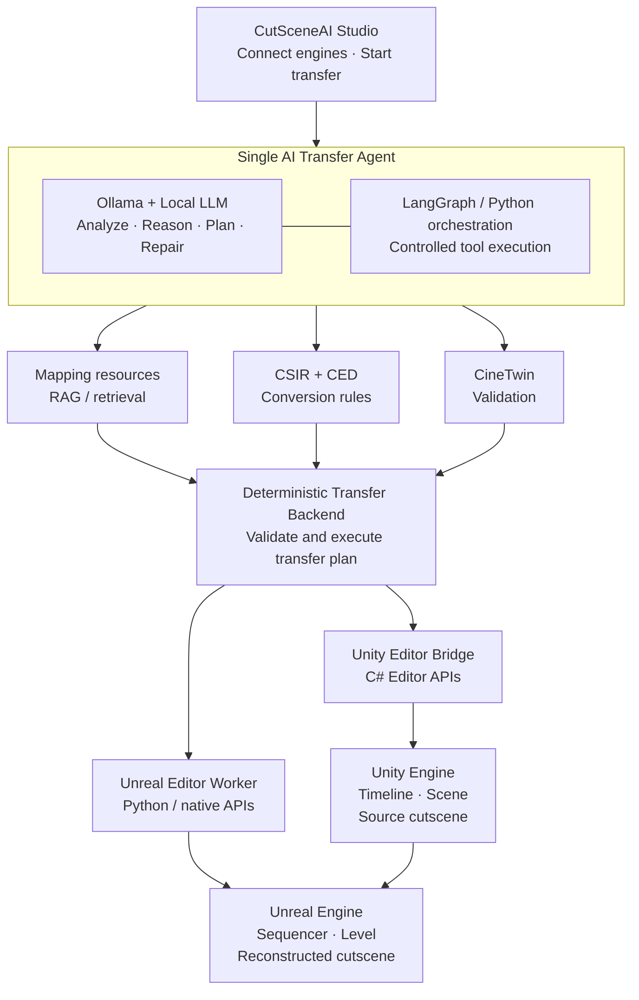

# CutScene Studio — Project Context and Handoff

Last updated: 2026-11-26

## 1. Start here — mandatory development workflow

- The active repository is https://github.com/Nithin0553/CutScene-Studio.git. The older CutSceneAI repository is not the active development target.
- At the start of every new development chat or session, read this file from the latest relevant branch, inspect the repository state and recent commits, and resume from the recorded next steps. Verify claims against the code rather than relying on chat memory.
- Every development update, code change, bug fix, configuration change, architectural decision, experiment, test result, or meaningful project update must be reflected in this file before the work is considered complete. Include the context update in the same commit or pull request whenever practical.
- Keep the current-state sections accurate and maintain a concise dated change history. Preserve important decisions and unresolved issues. Record changed paths, validation commands and actual results, blockers, and the next actionable step. Reference commits or PRs where available; do not invent identifiers.
- Keep the Git workflow simple: use main as the stable baseline and short-lived feature branches/PRs when appropriate. Use descriptive, natural commit messages; avoid unnecessary branches, unrelated changes and destructive Git operations.
- Never claim an implementation or test passed without evidence. Distinguish planned, implemented, tested with mocks, and verified in real editors. Do not commit secrets, private assets, local model weights or machine-specific credentials.

## 2. Project goal

Build a reliable local AI-powered cross-engine cutscene transfer application, initially Unity Timeline to Unreal Engine Sequencer, with reverse direction as a future goal. The application should connect to both editors, inspect the source scene and timeline, transfer required assets, reconstruct the cutscene in the target, validate fidelity and attempt bounded repairs where supported.

## 3. Approved architecture (mandatory; not yet implemented in this repository)

Approved by the user on 2026-11-26 from the supplied "Proposed CutSceneAI architecture" diagram. This is the sole architectural baseline for CutScene Studio. Do not introduce alternative architectures, additional agents, or change component responsibilities or connections without explicit user approval.



### Component responsibilities and interfaces

- **CutSceneAI Studio:** the user-facing interface for connecting engines and starting transfers; displays progress, diagnostics and validation results.
- **Single AI Transfer Agent:** the only AI agent. Ollama + a local LLM provide analysis, reasoning, planning and repair decisions. LangGraph / Python orchestrates controlled tool execution. Use a configurable local Ollama API (default http://localhost:11434); model choice is pending hardware and capability verification.
- **Mapping resources:** RAG / retrieval of relevant engine conversion knowledge, preferring exact component and version matches before optional semantic retrieval. Inspect prior mappings before reusing them.
- **CSIR + CED:** engine-independent cutscene representation and conversion rules/coverage. Source census can support extraction and coverage within these existing responsibilities; it is not an additional architectural layer.
- **CineTwin:** source-to-target validation and discrepancy evidence for bounded repair; validation feedback returns to the same single agent through controlled tools.
- **Deterministic Transfer Backend:** validates and executes the transfer plan using explicit conversion algorithms, schemas, job state and engine adapters. The three knowledge/validation components inform backend execution as shown in the approved diagram.
- **Unity Editor Bridge:** C# Editor APIs connect to Unity Engine and extract Timeline, scene, source cutscene, assets and capabilities.
- **Unreal Editor Worker:** Python / native APIs connect to Unreal Engine, import assets, create actors, reconstruct the Sequencer and Level, and obtain target readback.
- **Unity Engine → Unreal Engine:** the initial transfer direction. Unity contains the source cutscene; Unreal contains the reconstructed cutscene. The arrow denotes the transfer outcome, not an unmediated engine-to-engine API bypass.

### Non-negotiable implementation constraints

- Keep one Ollama-powered AI agent with LangGraph / Python orchestration. Do not substitute a multi-agent design, another orchestration architecture, or a parallel transfer pipeline without explicit approval.
- The agent selects grounded conversion strategies, invokes allowlisted tools and proposes supported repairs. Deterministic calculations, conversion, validation and editor mutations remain in the backend and engine adapters.
- Validate tool arguments and transfer plans, retain provenance, bound repair attempts, and explicitly report unsupported or partial conversions. Avoid arbitrary generated code execution and unintended changes to source projects.
- Preserve the diagram's named components and topology. Implementation details may evolve within their responsibilities; architectural changes require explicit user approval and a context.md update.
- The prior research concepts are intended for review and selective porting; their implementation in this repository has not been verified.
- No runtime implementation or real-engine transfer test is implied by architecture approval.

## 4. Current repository state

- Default branch: main.
- Baseline inspection on 2026-11-26 found only README.md at the root; its description is "The newer and solid version of the Studio."
- This context file establishes the development baseline and handoff workflow.
- User reports Ollama is already installed locally. Installed models, GPU, RAM, available storage and engine versions have not yet been verified. User reports an existing clone at `D:\My Studio\CutScene Studio\CutScene-Studio`; local Git status and remote remain unverified.
- No application code, integration tests, or real engine transfer results have been verified in this repository as of this entry.
- Prior research code and benchmarks must be reviewed explicitly before reuse. Do not assume prior implementations or results are present here.

## 4A. Mandatory local storage policy — D: (Dimpu)

User explicitly requires D: for the entire project; do not intentionally place project files, models, virtual environments, downloads, assets, caches, logs, temporary files, exports, benchmarks, or engine projects on C:. The local workspace layout uses the existing clone identified by the user (local Git state pending verification):

- Root: `D:\My Studio\CutScene Studio`
- Repository: `D:\My Studio\CutScene Studio\CutScene-Studio`
- Ollama models: `D:\My Studio\CutScene Studio\models\ollama`
- Unity/Unreal projects: `D:\My Studio\CutScene Studio\engine-projects\Unity` and `D:\My Studio\CutScene Studio\engine-projects\Unreal`
- Python virtual environment: repository `.venv` on D:; pip/npm/Unity/Unreal/Hugging Face caches under root `cache`
- Assets, temporary files, logs, exports and backups: corresponding folders under root.

Configure OLLAMA_MODELS before any model pulls, preserve existing models by copying from their actual current location if needed, restart Ollama, and verify models on D: before considering deletion of old copies. Set project-scoped cache and temp variables (PIP_CACHE_DIR, npm_config_cache, HF_HOME, TEMP, TMP); configure Unity and Unreal cache locations using supported version-specific settings before launching engine projects. Keep large local artifacts out of Git. Prefer new tool installs on D: where supported; existing OS and tool binaries/settings may reside on C: and third-party system-level writes cannot be guaranteed absent. Do not delete or move installed applications or Windows files without explicit approval. No local filesystem changes have been verified by this chat.

## 5. Development roadmap

1. Verify local environment and Ollama model/API availability; review relevant prior implementation and decide what to reuse.
2. Establish project structure, configuration, shared contracts and reproducible tests.
3. Implement minimal Unity and Unreal editor connectivity and capability discovery.
4. Define source extraction, CSIR and mapping retrieval interfaces.
5. Implement deterministic asset and timeline reconstruction for a minimal benchmark.
6. Integrate the single Ollama agent using LangGraph / Python orchestration, typed tool calls and validated plans.
7. Add target readback, CineTwin validation, bounded repair and transparent coverage reporting.
8. Integrate Studio UI and run end-to-end real-engine benchmarks; expand supported features incrementally.
9. Evaluate reverse transfer separately after the initial direction is reliable.

## 6. Next actionable step

First verify the existing clone at `D:\My Studio\CutScene Studio\CutScene-Studio` using git remote -v, git branch --show-current, git status, and git log -5 --oneline. Do not clone again. After confirming the correct remote, fetch origin; only fast-forward main if the working tree is clean and the current branch is main. Configure model/cache storage on D: before installing dependencies or downloading models. Verify existing tool locations and model paths, then select the model based on hardware. Do not move existing installations blindly.

Verify the developer machine using PowerShell:

```powershell
ollama list
Invoke-RestMethod http://localhost:11434/api/tags
nvidia-smi
Get-CimInstance Win32_ComputerSystem | Select-Object TotalPhysicalMemory
```

If nvidia-smi is unavailable, check the installed GPU using Windows tools. Confirm Unity/Unreal versions and available disk space before selecting a model and starting implementation. Review the older research repository before deciding which modules to port. No model downloads or local editor actions have been performed by this session.

## 7. Change history

### 2026-11-26 — Reuse existing local clone

- User identified the existing repository at `D:\My Studio\CutScene Studio\CutScene-Studio`. Use its parent as the project workspace; do not create a duplicate clone. Supersedes the earlier proposed D: workspace layout.
- Next: verify local remote, branch, working tree and recent commits before synchronizing, then inspect Ollama and hardware. No local changes or tests performed by this session.

### 2026-11-26 — D: drive storage policy

- Recorded the user's mandatory D: (Dimpu) storage requirement and proposed local folder layout, including Ollama model storage, caches, dependencies and engine projects.
- Updated initial setup order to verify and configure D: before downloads and development. Existing Windows/tool system writes are an acknowledged limitation.
- Documentation-only change; local setup and tests not performed. Next: user runs initial PowerShell setup and shares environment verification outputs.

### 2026-11-26 — Approved architecture locked

- User approved the exact supplied architecture diagram as the sole development baseline.
- Replaced the tentative architecture section with the approved component topology, Mermaid diagram, responsibilities and mandatory constraints. LangGraph / Python orchestration is now required, not an undecided alternative.
- Retained existing handoff rules, project state, roadmap and baseline history. No application code was changed.
- Validation: documentation-only update; no software or real-editor tests run.
- Next: verify local environment and review reusable research components, then implement within the approved architecture.

### 2026-11-26 — Project baseline and continuity

- Designated CutScene-Studio as the active repository.
- Established context.md as the required living handoff document.
- Recorded the proposed local Ollama single-agent architecture and deterministic engine execution approach.
- Verified the main branch root listing and README through GitHub; no application code was present in that listing.
- Documentation-only change; no software tests run.
- Next: verify local environment and review reusable research components.
